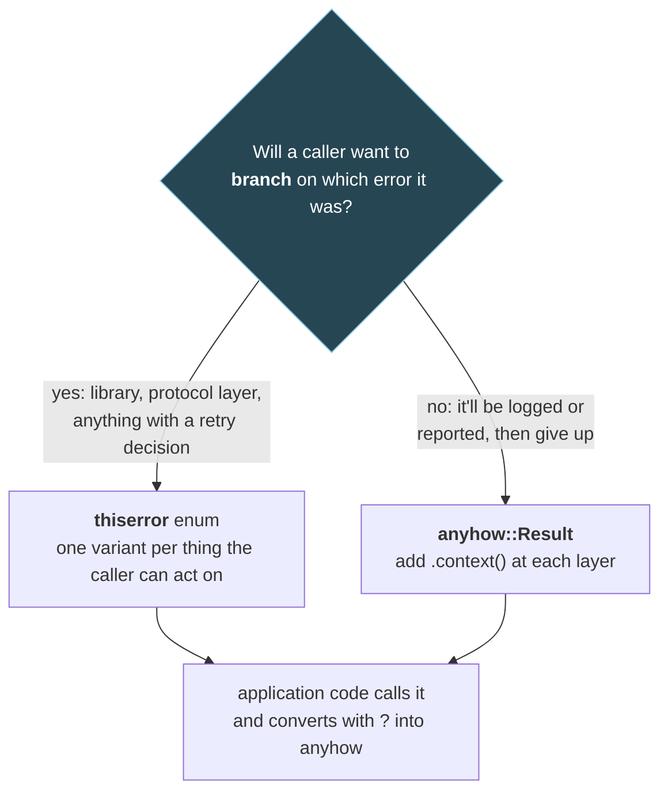

# 3. Errors: `Result`, `?`, and panics

## The problem

Go and Rust agree on the big idea: errors are ordinary values returned from functions,
not exceptions thrown through them. Where they differ is in what the compiler makes you
do with the value. In Go, `v, err := f()` gives you both halves, and nothing stops you
using `v` without looking at `err`, or writing `_` for the error, or returning `nil, nil`.
Wrapping is a formatting convention (`%w`) and inspection is a runtime walk
(`errors.Is`, `errors.As`). Rust puts the value and the error in one enum, so you can't
reach one without deciding about the other, and wrapping and inspection lean on types.
This chapter maps the Go habits across and covers the one decision Go doesn't make you
take: which error *type* each function returns.

## 3.1 `Result` and `Option` are just enums

From [chapter 1 §1.3](01-foundations.md#13-enums-carry-data-and-match-must-cover-them-all):

```rust
enum Result<T, E> { Ok(T), Err(E) }
enum Option<T>    { Some(T), None }
```

There's no magic. A function that can fail returns `Result<T, E>`, and the caller has to
take it apart to get at the `T`:

```rust
match "42".parse::<u16>() {
    Ok(port) => println!("port {port}"),
    Err(e) => eprintln!("bad port: {e}"),
}
```

Ignoring a `Result` entirely gets a warning, because the type is marked `#[must_use]`.
rustc 1.96 on a bare `f();` where `f` returns `Result`:

```
warning: unused `Result` that must be used
```

The table of everyday equivalents:

| Go | Rust | Note |
|---|---|---|
| `v, err := f(); if err != nil { return nil, err }` | `let v = f()?;` | §3.2 |
| `v, _ := f()` (ignore the error) | `let v = f().unwrap();` | Panics on error. `expect("why it can't fail")` is the polite form |
| `if v == nil` | `if let Some(v) = maybe { … }` / `match` | |
| `v, ok := m[k]` | `m.get(&k)` → `Option<&V>` | |
| Default when absent | `maybe.unwrap_or(default)` / `unwrap_or_default()` | |
| `return nil, nil` | Not expressible | If "nothing" is valid, return `Result<Option<T>, E>` and say so in the type |

That last row is a real class of Go bug that Rust's types remove: a function that returns
neither a value nor an error, and a caller that dereferences the nil.

## 3.2 The `?` operator

`?` on a `Result` means: if it's `Ok(v)`, evaluate to `v`; if it's `Err(e)`, return
`Err(e)` from the current function right now. It's Go's `if err != nil { return … }` as a
single character. It also works on `Option` inside a function that returns `Option`.

The part Go doesn't have: on the way out, `?` converts the error. The Book
([ch09-02](https://doc.rust-lang.org/book/ch09-02-recoverable-errors-with-result.html)):
"Error values that have the ? operator called on them go through the from function,
defined in the From trait in the standard library". So if your function returns
`Result<T, MyError>` and `MyError` implements `From<std::io::Error>`, then `?` on an I/O
result turns the `io::Error` into a `MyError` automatically. That conversion is the hook
both libraries in §3.4 hang off.

## 3.3 What an error type is

In Go, an error is anything with an `Error() string` method, and wrapping is the
convention of an `Unwrap() error` method, which `fmt.Errorf("…: %w", err)` provides
([Go blog: working with errors in Go 1.13](https://go.dev/blog/go1.13-errors)).

Rust's equivalent is the `std::error::Error` trait. A type implements it by implementing
`Display` (the message, like `Error()`) and `Debug`, and optionally `source()`, which
returns the underlying error, like `Unwrap()`. So the chain is the same idea: each error
can point at the one that caused it.

| Go | Rust |
|---|---|
| `error` interface | `std::error::Error` trait |
| `Error() string` | `impl Display` |
| `Unwrap() error` | `fn source(&self) -> Option<&(dyn Error + 'static)>` |
| `errors.New("x")` | A variant of your own enum, or `anyhow!("x")` |
| `fmt.Errorf("doing y: %w", err)` | `.context("doing y")` (anyhow) or a variant holding the source (thiserror) |
| `errors.Is(err, ErrNotFound)` | `matches!(err, MyError::NotFound)` on a typed error; `downcast_ref` on `anyhow::Error` |
| `errors.As(err, &target)` | `err.downcast_ref::<T>()` |
| Sentinel `var ErrX = errors.New(…)` | An enum variant |

Writing those trait implementations by hand is tedious, which is why almost every Rust
codebase uses one or both of two crates by the same author, David Tolnay.

## 3.4 `thiserror` for libraries, `anyhow` for applications

The two crates answer different questions. Their own READMEs draw the line. thiserror's
([README](https://github.com/dtolnay/thiserror#comparison-to-anyhow)):

> Use thiserror if you care about designing your own dedicated error type(s) so that the
> caller receives exactly the information that you choose in the event of failure. This
> most often applies to library-like code. Use Anyhow if you don't care what error type
> your functions return, you just want it to be easy. This is common in application-like
> code.

### `thiserror`: an enum the caller can match on

`thiserror` is a derive macro that writes `Display`, `Error` and `From` for an enum you
design. It "deliberately does not appear in your public API"
([docs](https://docs.rs/thiserror/latest/thiserror/)): the generated code is the same as
if you'd written it by hand.

```rust
use std::num::ParseIntError;
use thiserror::Error;

#[derive(Debug, Error)]
pub enum FrameError {
    #[error("frame too short: {len} bytes, need at least {min}")]
    TooShort { len: usize, min: usize },
    #[error("unknown frame type {0:#04x}")]
    UnknownType(u8),
    #[error("bad length field")]
    BadLength(#[from] ParseIntError),
}

fn parse_len(s: &str) -> Result<usize, FrameError> {
    Ok(s.trim().parse::<usize>()?)   // ParseIntError → FrameError, via #[from]
}
```

`#[error("…")]` is the `Display` text. `#[from]` generates the `From` impl that `?` uses,
and also makes that field the `source()`. A caller can now branch on what went wrong,
which is the point of a typed error:

```rust
match parse_frame(&buf) {
    Err(FrameError::UnknownType(t)) => skip_frame(t),
    Err(e) => return Err(e.into()),
    Ok(frame) => handle(frame),
}
```

And because it's an enum, adding a variant breaks every exhaustive `match` on it. For a
library that's a breaking change, which is honest: callers really do need to think about
the new failure.

### `anyhow`: one error type that holds anything, plus context

`anyhow::Error` is "a trait object based error type for easy idiomatic error handling in
Rust applications" ([docs](https://docs.rs/anyhow/latest/anyhow/)). Any error that
implements `std::error::Error` converts into it with `?`, and `.context(…)` wraps it with
a message, the way `%w` does:

```rust
use anyhow::{bail, Context, Result};   // Result<T> = Result<T, anyhow::Error>

fn load(path: &str) -> Result<usize> {
    let text = std::fs::read_to_string(path)
        .with_context(|| format!("reading frame length from {path}"))?;
    let n = parse_len(&text).context("parsing frame length")?;
    if n == 0 { bail!("frame length must be positive"); }
    Ok(n)
}

fn main() -> Result<()> {
    load("/nonexistent/len.txt")?;
    Ok(())
}
```

Run with anyhow 1.0.104 and thiserror 2.0.21, a missing file prints the whole chain and
exits non-zero:

```
Error: reading frame length from /nonexistent/len.txt

Caused by:
    No such file or directory (os error 2)
```

With a file containing `12x`, formatting the error with `{:#}` gives the chain on one line,
which is what you want in a log:

```
parsing frame length: bad length field: invalid digit found in string
```

and `err.downcast_ref::<FrameError>()` still found the `FrameError::BadLength` inside,
through the context layer. That's `errors.As`.

### Which, where



Most real programs use both: typed errors at module boundaries where someone decides
something (retry, reconnect, drop the frame), `anyhow` from there up to `main`. The
question isn't library versus binary as such. It's whether anybody will `match` on it.

> **Teacher's aside.** The Go habit to unlearn is the one-line wrap at every level:
> `fmt.Errorf("read config: %w", err)` in every function. In Rust you'll be tempted to
> make one giant error enum with a variant per call site, which is the same habit in a
> heavier coat. Variants are for decisions a caller makes. Context strings are for the
> human reading the log. If no code will ever branch on it, it's context, not a variant.

## 3.5 Panics are not errors

`panic!` is for bugs: a state the program believed impossible. The Book: "It's advisable
to have your code panic when it's possible that your code could end up in a bad state"
([ch09-03](https://doc.rust-lang.org/book/ch09-03-to-panic-or-not-to-panic.html)), where a
bad state is a broken assumption rather than an expected failure. `unwrap()`, `expect()`,
out-of-bounds indexing and (in debug builds) integer overflow all panic.

So far, like Go. The difference is what a panic *does* to the rest of the program.

| | Go | Rust |
|---|---|---|
| Panic in the main thread | Runs deferred calls, then the program exits | Unwinds (runs destructors), then the program exits |
| Panic in another goroutine / thread | **The whole program exits.** The spec: after deferred functions run, "the program is terminated and the error condition is reported" ([spec](https://go.dev/ref/spec#Handling_panics)), unless that goroutine recovers | Only that thread unwinds. `JoinHandle::join` returns `Err` "with the parameter given to panic!" ([docs](https://doc.rust-lang.org/std/thread/struct.JoinHandle.html#method.join)) |
| Panic in a tokio task | — | Caught by the runtime; awaiting the `JoinHandle` returns a `JoinError` ([tokio::task](https://docs.rs/tokio/latest/tokio/task/index.html)) |
| Catch it | `recover()` in a deferred function | `std::panic::catch_unwind`, rarely used |
| Make every panic fatal | Default | `panic = 'abort'` in the Cargo profile ([ch09-01](https://doc.rust-lang.org/book/ch09-01-unrecoverable-errors-with-panic.html)) |

I checked the tokio row: a task that called `panic!("boom")` printed the panic message,
and `handle.await` returned an error whose `is_panic()` was true, while `main` carried on.

> ⚠️ **A panicking task doesn't take the process down, so it can fail silently.** In Go,
> a goroutine panic is loud: the process dies and your supervisor restarts it. In tokio,
> if nobody awaits the `JoinHandle`, the panic is printed to stderr and the task is just
> gone. A connection handler that panics on a malformed frame stops serving that
> connection and nothing else notices. Either await your handles (a `JoinSet` makes this
> easy, [chapter 7 §7.6](07-concurrency-patterns.md#76-waiting-for-a-group-joinset-versus-waitgroup-and-errgroup)),
> or decide that a panic anywhere should be fatal and set `panic = 'abort'`.

Panics also interact with locks. If a thread panics while holding a `std::sync::Mutex`,
the mutex becomes **poisoned**, and later `lock()` calls return an error, because the data
"is likely tainted (some invariant is not being upheld)"
([std::sync::Mutex](https://doc.rust-lang.org/std/sync/struct.Mutex.html#poisoning)). That's
why you see `.lock().unwrap()` everywhere: it turns "someone panicked mid-update" into a
panic here too. Go's `sync.Mutex` has no such idea; a recovered panic can leave a mutex
locked or the data half-written, and nothing tells the next user.

## Check yourself

1. A Go function returns `(*User, error)` and sometimes returns `nil, nil` for "not
   found". Write the Rust signature that expresses the same contract, and say what the
   caller is now forced to do that the Go caller wasn't.
2. Your function returns `Result<Config, ConfigError>` and calls `std::fs::read_to_string`
   with `?`. It doesn't compile. What's missing, and what are two ways to supply it?
3. You're writing a module that decodes network frames. One caller drops bad frames and
   carries on; another closes the connection on any error. `anyhow` or `thiserror`, and
   why?
4. In Go, a nil-pointer dereference in one request's goroutine crashes the whole server.
   In a tokio server, a `panic!` in one connection's task does what? Is that better?
5. A thread panics while holding a `std::sync::Mutex<Vec<Order>>` halfway through
   updating it. What does the next `lock()` return, and why is that more useful than Go's
   behaviour in the same situation?

(Answers in [10-exercises.md](10-exercises.md).)
