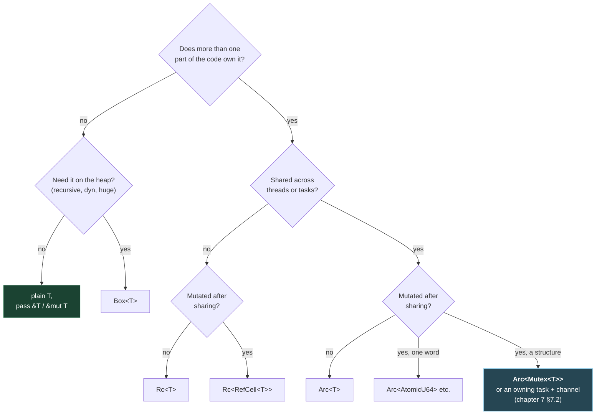

# 5. Shared state: `Box`, `Rc`, `Arc`, `Mutex`, `RefCell`, threads and `Drop`

## The problem

In Go, sharing is free and safety is your job. Any goroutine can hold a pointer to
anything; a `sync.Mutex` sits next to the data it protects, and only convention links
them. Rust's one-owner rule ([chapter 2](02-ownership-and-borrowing.md)) means sharing
can't be implicit. When two parts of a program, or two threads, need the same value, you
have to say how: who owns it, how ownership is counted, and how mutation is made safe.
Rust gives you a small set of wrapper types for that, and the hard part for a newcomer
isn't any one of them. It's knowing which to reach for. This chapter is the set, a way to
choose, plain OS threads, and how cleanup works without `defer`.

The OS-level background, what a thread is and how mutexes and deadlocks work in general,
is in the interview course:
[cs-fundamentals 02 §2.4](../interview/cs-fundamentals/02-processes-and-threads.md#24-threads-and-who-manages-them)
on threading models and
[cs-fundamentals 04](../interview/cs-fundamentals/04-synchronisation-and-deadlock.md) on
races, locks and deadlock. I won't repeat them here.

## 5.1 `Box<T>`: one owner, on the heap

`Box<T>` puts a `T` on the heap and owns it. Dropping the box frees it. It's the closest
thing to a Go `*T` from `new(T)`, minus the sharing: there's still exactly one owner.

You need it in three situations:

| Need | Why `Box` | Example |
|---|---|---|
| A recursive type | A type can't contain itself by value (infinite size), but it can contain a pointer to itself | `enum Expr { Num(f64), Add(Box<Expr>, Box<Expr>) }` |
| A trait object you own | `dyn Trait` has no fixed size; a box gives it one | `Box<dyn Codec>`, `Box<dyn Error>` |
| Move a big value cheaply | Moving a `Box` moves one pointer | Large buffers passed through channels |

## 5.2 `Rc<T>` and `Arc<T>`: shared ownership by counting

When a value genuinely has several owners, with no obvious one to outlive the rest, you
count them. `Rc<T>` (reference counted) keeps a count beside the value; `Rc::clone(&x)`
bumps it and hands out another owning pointer; each drop decrements it; the last one
frees the value. **`Arc<T>`** is the same with an *atomic* count, so it's safe across
threads.

| | `Rc<T>` | `Arc<T>` |
|---|---|---|
| Count updates | Plain increment | Atomic increment |
| `Send` / `Sync` | Neither ([chapter 4 §4.6](04-traits-and-generics.md#46-send-and-sync-marker-traits)) | Yes, if `T: Send + Sync` |
| Use | Shared ownership within one thread | Shared ownership across threads or tasks |
| What you get through it | `&T` only | `&T` only |

The last row is the one people miss. **`Arc<T>` gives you shared, read-only access.**
Shared XOR mutable still holds, so `Arc<Vec<u8>>` lets many threads read the vector and
none modify it. To mutate through shared ownership you need interior mutability (§5.3).

`clone()` on an `Arc` is cheap: an atomic increment, no copy of `T`. Cloning an `Arc`
to hand to each spawned thread or task is the normal pattern, not a smell.

> ⚠️ **Reference counting leaks cycles.** If `A` holds an `Rc` to `B` and `B` holds one
> to `A`, neither count reaches zero. The Book is direct about it: "Rust's memory safety
> guarantees make it difficult, but not impossible, to accidentally create memory that is
> never cleaned up (known as a memory leak)… memory leaks are memory safe in Rust"
> ([ch15-06](https://doc.rust-lang.org/book/ch15-06-reference-cycles.html)). Go's
> tracing GC collects cycles; Rust's counting doesn't. Break cycles with `Weak<T>`,
> which points without owning: parent-to-child links are `Rc`, child-to-parent links are
> `Weak`.

## 5.3 Interior mutability: mutation through a shared reference

Sometimes the borrow rules are too strict for a correct program: a cache that fills in on
read, a counter shared by several owners, state behind an `Arc`. **Interior mutability**
is a set of types that allow mutation through a `&T`, by moving the "one writer at a
time" check from compile time to run time, or by making it unnecessary.

| Type | Threads | How it stays safe | When the rule is broken |
|---|---|---|---|
| `Cell<T>` | One | Only lets you copy values in and out, never borrow the inside | Can't be: no references to the inside exist |
| `RefCell<T>` | One | Counts borrows at run time | **Panics** |
| `Mutex<T>` | Many | A lock | The second locker waits |
| `RwLock<T>` | Many | Many readers or one writer, with a lock | Waits |
| `AtomicU64`, `AtomicBool`, … | Many | CPU atomic instructions | Can't be broken; only single-word operations |
| `OnceLock<T>` | Many | Set once, then read-only | Second set returns `Err` |

`RefCell` deserves a demonstration, because it's the borrow checker's rules enforced at
run time, and it fails differently:

```rust
let log = RefCell::new(Vec::<String>::new());
let first = log.borrow_mut();
let second = log.borrow_mut();   // compiles; panics at run time
```

```
thread 'main' panicked at rcell.rs:5:22:
RefCell already borrowed
```

`Rc<RefCell<T>>` is the single-threaded "shared and mutable" combination;
**`Arc<Mutex<T>>`** is the multi-threaded one. You'll write the second a lot.

## 5.4 `Arc<Mutex<T>>`: the data lives inside the lock

Here is the shape that Go programmers find strange at first and then miss when they go
back:

```rust
use std::sync::{Arc, Mutex};
use std::thread;

let counter = Arc::new(Mutex::new(0u64));
let mut handles = Vec::new();
for _ in 0..1000 {
    let c = Arc::clone(&counter);
    handles.push(thread::spawn(move || {
        *c.lock().unwrap() += 1;
    }));
}
for h in handles { h.join().unwrap(); }
println!("{}", *counter.lock().unwrap());   // 1000, every run
```

Compare the Go:

```go
type Stats struct {
    mu    sync.Mutex
    count int // protected by mu (by convention)
}
```

| | Go `sync.Mutex` | Rust `Mutex<T>` |
|---|---|---|
| Where the data is | Beside the mutex, linked by a comment | **Inside** the mutex |
| Reaching the data without locking | Compiles | Doesn't compile: the only way in is `lock()` |
| Unlocking | `mu.Unlock()`, usually via `defer` | When the guard returned by `lock()` is dropped |
| Forgetting to unlock | Possible | Not possible; leaving the scope unlocks |
| Re-locking on the same thread | Deadlocks (Go mutexes aren't re-entrant) | "left unspecified… it might panic or deadlock" ([docs](https://doc.rust-lang.org/std/sync/struct.Mutex.html#method.lock)) |
| A holder panicked | Nothing records it | The mutex is **poisoned** ([chapter 3 §3.5](03-errors.md#35-panics-are-not-errors)) |
| Deadlock from lock ordering | Possible | Possible |

The last row matters. Rust's types prevent data races; they don't prevent deadlocks. The
Nomicon: "it is considered 'safe' for Rust to get deadlocked"
([races](https://doc.rust-lang.org/nomicon/races.html)). Two threads taking two mutexes
in opposite orders deadlock exactly as in Go, and the fix is the same: a global lock
order. See [cs-fundamentals 04 §4.9](../interview/cs-fundamentals/04-synchronisation-and-deadlock.md#49-deadlock)
and §4.10.

> **Teacher's aside.** The comment `// protected by mu` in Go is a fact stated in two
> places that must agree: the comment, and every access site. Nothing checks them. Rust's
> `Mutex<T>` deletes the duplication by making the lock the owner of the data. You can't
> touch the data without the guard, and the guard is the lock. Most of Rust's concurrency
> safety comes from that move, packaging the rule and the thing it protects into one value,
> rather than from anything clever at run time.

For a single counter or flag, an atomic is simpler and cheaper than a mutex:
`AtomicU64::fetch_add(1, Ordering::Relaxed)` from eight threads, 1,000 times each, gave
8,000. Memory orderings are a topic of their own; `Relaxed` is fine for a
counter nobody uses to synchronise other data, and `SeqCst` is the safe default when
you're not sure.

## 5.5 Choosing a wrapper



The green box is the one to prefer. Most "how do I share this" questions have the answer
"don't": pass a reference down the call stack, or give the value to the one thread that
needs it.

## 5.6 OS threads

`std::thread::spawn` starts an OS thread: the standard library "uses a *1:1* model of
thread implementation" ([Book ch16-01](https://doc.rust-lang.org/book/ch16-01-threads.html);
background in [cs-fundamentals 02 §2.4](../interview/cs-fundamentals/02-processes-and-threads.md#24-threads-and-who-manages-them)).
Each costs a real stack and a kernel thread, so you don't start one per request the way
you start a goroutine. For many concurrent I/O-bound tasks you use async
([chapter 6](06-async-and-tokio.md)). Threads are for CPU work, blocking libraries, and
anything that needs a dedicated, predictable thread, such as an audio callback.

The closure must be `Send + 'static`: it can't borrow from the spawning function, because
the thread might outlive it ([chapter 2 §2.7](02-ownership-and-borrowing.md#27-closures-borrow-or-move)).
`join()` returns a `Result`, `Err` if the thread panicked.

**Scoped threads** lift the `'static` requirement. `std::thread::scope` (since Rust 1.63)
guarantees every thread spawned inside it is joined before it returns, so the threads
*can* borrow locals: "Unlike non-scoped threads, scoped threads can borrow non-'static
data, as the scope guarantees all threads will be joined at the end of the scope"
([docs](https://doc.rust-lang.org/std/thread/fn.scope.html)).

```rust
let mut chunks = vec![vec![1, 2], vec![3, 4], vec![5, 6]];
std::thread::scope(|s| {
    for c in chunks.iter_mut() {
        s.spawn(move || c.iter_mut().for_each(|x| *x *= 10));
    }
});
println!("{chunks:?}");   // [[10, 20], [30, 40], [50, 60]]
```

Each thread gets an `&mut` to a different chunk, so there's no lock and no `Arc`. The
borrow checker knows the mutable borrows don't overlap. The Go version is a `WaitGroup`
and a promise to yourself that each goroutine only touches its own index.

## 5.7 `std::sync::mpsc` channels

The standard library has channels too: **mpsc**, multi-producer single-consumer.
`mpsc::channel()` "conceptually has an infinite buffer"; `mpsc::sync_channel(n)` is
bounded, and `n = 0` makes it a rendezvous channel, like an unbuffered Go channel
([docs](https://doc.rust-lang.org/std/sync/mpsc/index.html)).

| | Go `chan T` | `std::sync::mpsc` |
|---|---|---|
| Consumers | Many | One (`Receiver` isn't `Clone`) |
| Bounded | `make(chan T, n)` | `sync_channel(n)` |
| Unbounded | Not built in | `channel()` |
| Closing | Sender calls `close(ch)`; send on closed **panics** | Channel closes when **every `Sender` is dropped**; send to a dropped receiver returns `Err` |
| `range` until closed | `for v := range ch` | `for v in rx.iter()` / `rx` |
| `select` | Built in | No; use tokio or `crossbeam-channel` |

The closing rule is the trap. A `Receiver` loop ends only when *all* senders are gone,
including the one you created at the top and cloned for each worker:

```rust
let (tx, rx) = mpsc::channel::<u32>();
let t2 = tx.clone();
thread::spawn(move || t2.send(1).unwrap());
for v in rx.iter() { println!("got {v}"); }   // prints "got 1", then blocks for ever
```

Run, this printed `got 1` and was still blocked when I killed it 1.5 s later, because
`tx` is still alive in `main`. Add `drop(tx);` before the loop. It's the Rust form of
Go's "forgot to close the channel, `range` never ends".

For async code you'll use tokio's channels instead; [chapter 7](07-concurrency-patterns.md)
compares them all.

## 5.8 `Drop` versus `defer`

Rust has no `defer`. Cleanup is attached to values: when a value is dropped, its `Drop`
implementation runs. Files close, guards unlock, sockets shut, all because their owner
went out of scope.

| | Go `defer` | Rust `Drop` |
|---|---|---|
| Attached to | A function call | A value's type |
| Runs when | The surrounding **function** returns | The owning **scope** (any `{ }` block) ends, or the value is dropped early |
| Order | "Last In First Out" ([Go blog](https://go.dev/blog/defer-panic-and-recover)) | Variables in "reverse order of declaration" ([Reference](https://doc.rust-lang.org/reference/destructors.html)) |
| In a loop | Accumulates until the function returns | Runs at the end of each iteration |
| Value moved elsewhere | — | Cleanup moves with it; runs wherever the new owner drops it |
| Explicit early run | — | `drop(x)` |
| On panic | Deferred calls run | Destructors run during unwinding (not with `panic = 'abort'`) |
| Guaranteed? | Unless the process exits | No: `std::mem::forget` is safe, because "Rust's safety guarantees do not include a guarantee that destructors will always run" ([docs](https://doc.rust-lang.org/std/mem/fn.forget.html)) |

Ownership makes this more flexible than `defer`. A function can open a file and *return*
it, and the close happens wherever the caller lets go. A `defer f.Close()` can't follow
the file out of the function.

> ⚠️ **`let _ = guard;` drops immediately; `let _guard = guard;` doesn't.** The pattern
> `_` doesn't bind, so the value is dropped at the end of the statement. A name starting
> with an underscore is a real binding that lives to the end of the scope. Run with this
> `Drop` that prints:
>
> ```rust
> let _ = Guard("underscore");
> let _g = Guard("named _g");
> {
>     let _inner = Guard("inner block");
>     println!("end of inner block");
> }
> let a = Guard("a");
> let b = Guard("b");
> drop(a);
> println!("end of main");
> ```
>
> ```
> drop underscore
> end of inner block
> drop inner block
> drop a
> end of main
> drop b
> drop named _g
> ```
>
> `underscore` is gone before anything else runs. With a mutex guard or a tracing span,
> that means the lock or span covers nothing at all.

There's no `async` version of `Drop`: a destructor can't `.await`. If cleanup needs I/O,
such as sending a goodbye frame or flushing to a socket, do it explicitly before the value
goes out of scope, and treat `Drop` as the backstop.

## Check yourself

1. You have `Arc<Vec<Order>>` shared by four threads and one needs to append an order.
   Why doesn't `orders.push(o)` compile, and what are two ways to restructure?
2. A parent object holds `Rc<Child>` for each child, and each child holds `Rc<Parent>`.
   What happens when the last outside reference to the parent is dropped? What do you
   change?
3. In Go you'd write `mu.Lock(); defer mu.Unlock()` at the top of a long function that
   only needs the lock for three lines. What's the Rust equivalent, and how do you make
   the lock cover only those three lines?
4. A worker pool receives from `std::sync::mpsc` and the main thread waits on
   `rx.iter()`. All workers finish, but the program hangs. What's the most likely cause?
5. `RefCell` and `Mutex` both allow mutation through a shared reference. What does each do
   when the rule is violated, and why can't `RefCell` be shared between threads?
6. You write `let _ = span.enter();` to time a block with a tracing span, and the timings
   all come out near zero. Why?

(Answers in [10-exercises.md](10-exercises.md).)
