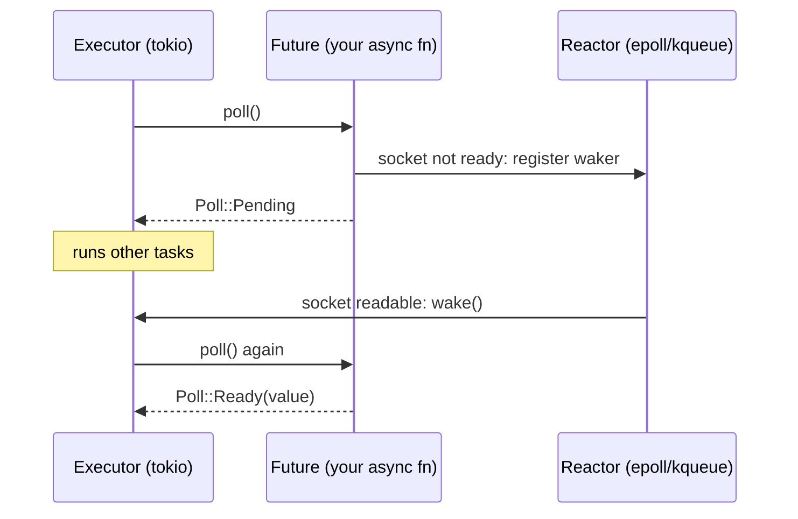

# 6. Async Rust and tokio, against goroutines

## The problem

Go hides asynchrony completely. You write blocking-looking code, `conn.Read(buf)`, and
the runtime parks the goroutine and wakes it when the socket is readable. Every goroutine
has its own growable stack, the scheduler preempts long-running ones, and you never
choose a runtime because there's only one. Rust makes every one of those things visible.
An `async fn` doesn't run when you call it. There's no scheduler unless you add one.
Tasks are only switched at `.await`, so a slow loop or a blocking call freezes every
other task on that thread. And the compiler checks things about your tasks, such as
whether they can move between threads, that Go never asks. The result can be very fast
and very predictable, but the Go intuitions that carry over are fewer than the shared
vocabulary suggests.

The threading-model background, 1:1 versus M:N and why Rust removed its green-thread
runtime before 1.0, is in
[cs-fundamentals 02 §2.4 and §2.6](../interview/cs-fundamentals/02-processes-and-threads.md#24-threads-and-who-manages-them).
This chapter assumes it.

## 6.1 What an `async fn` is

An `async fn` returns a **future**: a value representing a computation that hasn't
finished. The `Future` trait has one method, `poll`, which "attempts to resolve the future
into a final value. This method does not block if the value is not ready. Instead, the
current task is scheduled to be woken up when it's possible to make further progress by
polling again" ([std::future::Future](https://doc.rust-lang.org/std/future/trait.Future.html)).

The compiler turns the body of an `async fn` into a **state machine**: one state per
`.await` point, holding whichever local variables are still needed after it. That's the
key difference from a goroutine. A goroutine has a stack; a future is a struct whose size
is fixed at compile time and contains exactly the variables that live across an
`.await`.



Futures are **lazy**. The Book ([ch17-01](https://doc.rust-lang.org/book/ch17-01-futures-and-syntax.html)):
"futures in Rust are lazy: they don't do anything until you ask them to with the await
keyword". Run with tokio 1.53:

```rust
async fn say(msg: &str) { println!("{msg}"); }

let f = say("from the future");   // nothing printed yet
println!("future created");
f.await;                           // runs now
say("never awaited");              // never runs
```

```
future created
from the future
```

and the compiler warns about the last line: `unused implementer of Future that must be
used … futures do nothing unless you .await or poll them`. In Go, `go f()` starts `f`.
In Rust, `f()` on an `async fn` starts nothing.

There's one exception you'll rely on. `tokio::spawn` hands the future to the runtime,
and then it *does* start: "The provided future will start running in the background
immediately when spawn is called, even if you don't await the returned JoinHandle"
([tokio::spawn](https://docs.rs/tokio/latest/tokio/task/fn.spawn.html)). So
`tokio::spawn` is the Go `go` statement; calling an `async fn` is not.

## 6.2 Why Rust makes you choose a runtime

The Book again: "Most languages that support async bundle a runtime, but Rust does not.
Instead, there are many different async runtimes available, each of which makes different
tradeoffs suitable to the use case it targets. For example, a high-throughput web server
with many CPU cores and a large amount of RAM has very different needs than a
microcontroller with a single core". The standard library defines `Future` and the
`async`/`await` syntax (stable since Rust 1.39, [blog](https://blog.rust-lang.org/2019/11/07/Async-await-stable/));
the **executor** that polls futures and the **reactor** that waits on sockets come from a
crate.

For networked servers and clients, that crate is almost always **tokio**. Its pieces:

| Part | Does | Go equivalent |
|---|---|---|
| Runtime / scheduler | Polls tasks on worker threads, work-stealing | The `G`/`M`/`P` scheduler |
| Reactor (I/O driver) | Waits on sockets with epoll/kqueue/IOCP, wakes tasks | The netpoller |
| Timer | `sleep`, `timeout`, `interval` | `time.Sleep`, timers |
| `tokio::net` | Async TCP, UDP, Unix sockets | `net` |
| `tokio::sync` | Async channels, `Mutex`, `Semaphore`, `Notify` | `chan`, `sync` |
| Blocking pool | Threads for `spawn_blocking` | Threads the runtime spins up for blocking syscalls |

You start it with an attribute:

```rust
#[tokio::main]
async fn main() { … }
```

That builds a **multi-threaded** runtime, the default flavour, whose `worker_threads`
"defaults to the number of cpus on the system"
([tokio::main](https://docs.rs/tokio/latest/tokio/attr.main.html)). The other flavour is
`#[tokio::main(flavor = "current_thread")]`: one thread runs every task. It's simpler,
has no cross-thread overhead, and makes the cost of blocking very visible, which is why
I use it in §6.5.

> ⚠️ `tokio = { version = "1", features = ["full"] }` turns everything on. It's fine to
> start with, and it's what the tutorial uses, but every feature is compile time, and a
> library should never ask for `full`. [Chapter 8 §8.3](08-cargo-and-project-hygiene.md#83-features-additive-and-unified)
> covers features.

## 6.3 Tasks versus goroutines

tokio's docs use the comparison themselves: "If you are familiar with Go's goroutines,
Kotlin's coroutines, or Erlang's processes, you can think of Tokio's tasks as something
similar" ([tokio::task](https://docs.rs/tokio/latest/tokio/task/index.html)). Similar, with
differences that matter:

| | Goroutine | tokio task |
|---|---|---|
| Start | `go f()` | `tokio::spawn(fut)`; starts immediately |
| Memory | A growable stack; the runtime's minimum is 2 KiB ([cs-fundamentals 02 §2.6](../interview/cs-fundamentals/02-processes-and-threads.md#26-how-four-languages-do-it)) | The future's state machine, sized at compile time. Tokio's tutorial: "they require only a single allocation and 64 bytes of memory" ([spawning](https://tokio.rs/tokio/tutorial/spawning)), plus the future itself |
| Switching | Preemptive since Go 1.14; a tight loop can't hog a thread | **Cooperative**: "a task is allowed to run until it yields" ([tokio::task](https://docs.rs/tokio/latest/tokio/task/index.html)). Only at `.await` |
| Blocking call | Runtime hands the thread's `P` to another `M`; others keep running | **Blocks that worker thread** and every task queued on it (§6.5) |
| Result | Send it on a channel | `JoinHandle<T>`; `.await` it for a `Result<T, JoinError>` |
| Panic | Kills the process | Caught; surfaces as `JoinError` ([chapter 3 §3.5](03-errors.md#35-panics-are-not-errors)) |
| Cancel from outside | Not possible; ask via `context` | `handle.abort()`, or drop the future (§6.4 and [chapter 7](07-concurrency-patterns.md)) |
| Leak | Blocked for ever, never collected | Same: a task waiting for ever on a channel nobody sends to is never freed |
| Crossing threads | Free | Only if the future is `Send` (§6.4) |

Two rows change how you write code. **Cooperative scheduling** means a task that computes
for 50 ms without an `.await` holds its worker thread for 50 ms, and nothing will take it
away. And **cancellation from outside** means any `.await` is a point where your task
might stop for good. Go code never has to think about the second; [chapter 7 §7.4](07-concurrency-patterns.md#74-cancellation-safety)
is about it.

## 6.4 `Send + 'static` on spawn

`tokio::spawn`'s signature is the source of most early async errors:

```rust
pub fn spawn<F>(future: F) -> JoinHandle<F::Output>
where
    F: Future + Send + 'static,
    F::Output: Send + 'static,
```

**`'static`** means the task can't borrow from the function that spawned it. "The spawned
task must not contain any references to data owned outside the task"
([tutorial](https://tokio.rs/tokio/tutorial/spawning)), because nothing guarantees the
spawner outlives it. Same as `thread::spawn` ([chapter 2 §2.7](02-ownership-and-borrowing.md#27-closures-borrow-or-move)).
The fix is the same too: `async move { … }` and `Arc` for anything shared.

**`Send`** means the task can be moved between worker threads, which the multi-threaded
runtime does at any `.await`. Here's the subtle part. A future is `Send` if everything
*it holds across an `.await`* is `Send`. The tutorial: "Tasks are Send when all data that
is held across .await calls is Send." A non-`Send` value used and dropped between two
`.await`s doesn't matter; one that's still alive at an `.await` does.

The case everyone hits: holding a `std::sync::MutexGuard` across an `.await`.

```rust
tokio::spawn(async move {
    let mut n = c.lock().unwrap();
    *n += 1;
    save(*n).await;            // guard still alive across this .await
});
```

rustc 1.96, trimmed to the lines that matter:

```
error: future cannot be sent between threads safely
    = help: within `{async block@…}`, the trait `Send` is not implemented for `std::sync::MutexGuard<'_, u64>`
note: future is not `Send` as this value is used across an await
10 |         let mut n = c.lock().unwrap();
   |             ----- has type `std::sync::MutexGuard<'_, u64>` which is not `Send`
12 |         save(*n).await;
   |                  ^^^^^ await occurs here, with `mut n` maybe used later
```

The fix is to end the guard's scope before the `.await`:

```rust
let value = {
    let mut n = c.lock().unwrap();
    *n += 1;
    *n
};                         // guard dropped here
save(value).await;
```

> **Teacher's aside.** "Future cannot be sent between threads safely" reads like a
> threading error, and Go programmers go looking for a goroutine-equivalent bug. It's
> really a question about *what's alive at each `.await`*. Each `.await` is a point where
> the task may be parked, moved to another thread and resumed. Anything alive across it
> travels too. Read the `note:` lines: they name the value and the exact `.await`. Then
> shrink that value's scope so it dies before the `.await`, or swap it for a `Send`
> equivalent. Holding a lock while you wait on I/O is a bad idea in Go too; Rust just makes
> the common case a compile error.

## 6.5 Blocking inside async code

This is the bug that doesn't exist in Go and is easiest to write in Rust. tokio's docs:
"Tasks should generally not perform system calls or other operations that could block a
thread, as this would prevent other tasks running on the same thread from executing as
well" ([tokio::task](https://docs.rs/tokio/latest/tokio/task/index.html)).

To see it, a ticker task that wants to print every 100 ms, and a `main` that calls
`std::thread::sleep(500 ms)` (a stand-in for any blocking call) on a `current_thread`
runtime:

```rust
#[tokio::main(flavor = "current_thread")]
async fn main() {
    let start = Instant::now();
    let ticker = tokio::spawn(async move {
        for i in 0..3 {
            tokio::time::sleep(Duration::from_millis(100)).await;
            println!("tick {i} at {:?}", start.elapsed().as_millis());
        }
    });
    tokio::task::yield_now().await;                  // let the ticker start
    std::thread::sleep(Duration::from_millis(500));  // blocks the only worker
    println!("blocking sleep done at {:?}", start.elapsed().as_millis());
    ticker.await.unwrap();
}
```

Measured, tokio 1.53, times in ms:

```
blocking sleep done at 503
tick 0 at 504
tick 1 at 606
tick 2 at 707
```

The first tick was due at 100 ms and ran at 504. Replace the blocking line with
`tokio::task::spawn_blocking(|| std::thread::sleep(…)).await`:

```
tick 0 at 101
tick 1 at 203
tick 2 at 305
blocking sleep done at 502
```

On the multi-threaded runtime the symptom is quieter, because other workers pick up the
slack until every worker is blocked. Alice Ryhl, a tokio maintainer, explains why that
hides the problem: the default runtime has one thread per core, "enough that you can miss
the issue when testing locally, but sufficiently few that you will very quickly run out
of threads when running the code for real"
([Async: What is blocking?](https://ryhl.io/blog/async-what-is-blocking/), 2020). The
same post gives the only rule of thumb I know of for "how long is too long": "no more
than 10 to 100 microseconds between each .await". She adds that it depends on the
application; treat it as an order of magnitude, not a threshold.

**What counts as blocking:**

| Blocks the worker | Async alternative |
|---|---|
| `std::thread::sleep` | `tokio::time::sleep(…).await` |
| `std::fs`, `std::net`, any sync I/O | `tokio::fs`, `tokio::net` (`tokio::fs` itself uses the blocking pool) |
| A sync client library (some database drivers, HTTP clients) | Its async version, or `spawn_blocking` |
| CPU-heavy work: parsing a large body, compression, crypto | `spawn_blocking`, or `rayon` for parallel CPU work |
| Holding a `std::sync::Mutex` for a long time | Hold it briefly, or restructure (§6.6) |
| `Receiver::recv()` from `std::sync::mpsc` | `tokio::sync::mpsc`, `.recv().await` |
| A destructor that blocks | tokio warns this counts too: "This includes destructors of objects destroyed in async code" |

**The options when you must block:**

| Tool | What it does | Use for | Watch out |
|---|---|---|---|
| `spawn_blocking(f)` | Runs `f` on a separate pool of threads; returns a `JoinHandle` | Short blocking calls that "eventually finish on their own" | "cannot be aborted"; the pool's default limit is 512 threads ([Builder](https://docs.rs/tokio/latest/tokio/runtime/struct.Builder.html#method.max_blocking_threads)), so bound CPU work with a semaphore ([docs](https://docs.rs/tokio/latest/tokio/task/fn.spawn_blocking.html)) |
| `block_in_place(f)` | Turns the current worker into a blocking thread and moves its other tasks elsewhere | Blocking without sending the work to another thread; the docs say this "can improve performance by avoiding context switches" | Multi-threaded runtime only |
| `std::thread::spawn` | A dedicated OS thread | "long-lived or persistent blocking workloads" (spawn_blocking docs), and anything with timing needs of its own | You manage its lifetime; talk to it via channels ([chapter 7 §7.8](07-concurrency-patterns.md#78-crossing-between-os-threads-and-tasks)) |
| `rayon` | A work-stealing pool for CPU parallelism | Data-parallel computation | A separate pool; bridge results back with a channel |

> ⚠️ **`spawn_blocking` doesn't stop at shutdown.** "spawn_blocking tasks cannot be aborted
> once they start running, which means that runtime shutdown will wait indefinitely for
> all started spawn_blocking to finish running" ([docs](https://docs.rs/tokio/latest/tokio/task/fn.spawn_blocking.html)).
> A loop that runs for ever inside `spawn_blocking` hangs your shutdown. Long-lived loops
> belong on their own `std::thread`, with a way to tell them to stop.

## 6.6 `std::sync::Mutex` or `tokio::sync::Mutex`?

You'd guess the async one, in async code. tokio's own docs say otherwise: "Contrary to
popular belief, it is ok and often preferred to use the ordinary Mutex from the standard
library in asynchronous code. The feature that the async mutex offers over the blocking
mutex is the ability to keep it locked across an .await point. This makes the async mutex
more expensive than the blocking mutex"
([tokio::sync::Mutex](https://docs.rs/tokio/latest/tokio/sync/struct.Mutex.html)).

| Situation | Use |
|---|---|
| Protecting plain data, locked briefly, never across `.await` | `std::sync::Mutex` (or `parking_lot::Mutex`) |
| Must stay locked across an `.await`, e.g. a single connection used by many tasks | `tokio::sync::Mutex`, or better, below |
| Shared access to an I/O resource | A task that owns the resource, and a channel to it: "it is often better to spawn a task to manage the IO resource, and to use message passing" (same docs) |

The recommended pattern is to wrap `Arc<Mutex<…>>` in a struct whose methods are
synchronous and lock internally, so a guard can't escape into an `.await`. The owning-task
pattern is [chapter 7 §7.2](07-concurrency-patterns.md#72-a-task-that-owns-the-state).

## 6.7 `Pin`, briefly

You'll see `Pin<&mut Self>`, `Box::pin` and `tokio::pin!` soon after starting. The short
version: an async block's state machine can hold references to its own fields, for example
a buffer and a slice into that buffer, both alive across an `.await`. Moving such a value
would leave the internal reference pointing at the old address. The Book
([ch17-05](https://doc.rust-lang.org/book/ch17-05-traits-for-async.html)): "the futures
Rust creates for async blocks can end up with references to themselves in the fields…
any object that has a reference to itself is unsafe to move". `Pin` is a wrapper that
promises the value won't move again, which is what `poll` requires.

In practice: `.await` pins for you. You need to pin explicitly when you poll the same
future repeatedly by reference, such as in a `select!` loop
([chapter 7 §7.4](07-concurrency-patterns.md#74-cancellation-safety)), or when you store
futures of different types together (`Pin<Box<dyn Future<Output = T> + Send>>`). The
compiler's error message usually names the fix (`pin!` or `Box::pin`).

## Check yourself

1. You call `let f = fetch_user(id);` in an async function and then return early on an
   unrelated error. Did a request go out? What would the Go equivalent with `go` have
   done?
2. An async handler parses a 20 MB JSON body with a synchronous parser, taking about
   80 ms. On a 4-core box, what happens to other connections' latency as load rises, and
   what do you change?
3. Why does holding a `std::sync::MutexGuard` across an `.await` fail to compile inside
   `tokio::spawn`, but compile inside a plain `async fn` you call and await directly?
   Is the second case safe?
4. You need a background loop that reads a blocking device API for the life of the
   process. `spawn_blocking` or `std::thread::spawn`? Give two reasons.
5. A teammate replaces every `std::sync::Mutex` with `tokio::sync::Mutex` "because we're
   async now". What does that cost, and when is it actually needed?
6. Explain cooperative scheduling to a Go programmer in one paragraph, using a
   `for { }` loop that never calls anything as the example. What happens in each language?

(Answers in [10-exercises.md](10-exercises.md).)
