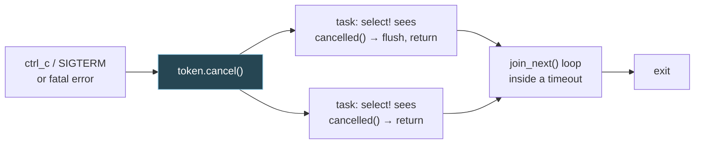
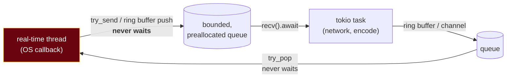

# 7. Concurrency patterns in tokio, against Go

## The problem

Most Go concurrency patterns have a tokio equivalent with a similar name: channels,
`select`, a way to cancel, a way to wait for a group. The translation is close enough
that you'll write working code on day one, and different enough in one place to cause
bugs for months. In Go, cancellation is cooperative: you pass a `context`, and a goroutine
stops only if it checks. In Rust, any future can be cancelled from outside by dropping
it, which happens at whichever `.await` it was parked on. That's how `select!`, timeouts
and `JoinSet` all work, and it means a function can stop halfway through, at an `.await`,
without its author having planned for it. This chapter maps the patterns and then spends
its time on that difference. It ends with how to connect async tasks to plain OS threads
that must never block.

## 7.1 Channels: which tokio type replaces your `chan`

Go has one channel type that does everything. tokio has four, each for one pattern
([tokio::sync](https://docs.rs/tokio/latest/tokio/sync/index.html)):

| Go usage | tokio type | Producers → consumers | Notes |
|---|---|---|---|
| `make(chan T, n)` work queue | `mpsc::channel(n)` | many → one | Bounded; `send().await` waits when full. "the channel capacity plays a critical part in handling back pressure" |
| `make(chan T)` with no limit wanted | `mpsc::unbounded_channel()` | many → one | `send` never waits, so it never pushes back. Memory is the limit |
| `make(chan T, 1)` for a single reply | `oneshot::channel()` | one → one | Sends exactly one value. The standard reply channel for a request |
| Fan-out to every subscriber | `broadcast::channel(n)` | many → many, **each gets every value** | Slow receivers lose messages (below) |
| "Latest config", "current state" | `watch::channel(init)` | many → many, **only the latest value** | "there is no guarantee that consumers will see all values" |
| `close(done)` to signal stop | `CancellationToken` (tokio-util) or `watch` | — | §7.5 |

Closing works differently from Go, and more safely:

| | Go | tokio `mpsc` |
|---|---|---|
| How a channel closes | The sender calls `close(ch)` | When every `Sender` is dropped |
| Receive after close | Zero value, `ok == false` | `recv().await` returns `None` |
| Send after close | **Panics**: "A send on a closed channel proceeds by causing a run-time panic" ([spec](https://go.dev/ref/spec#Send_statements)) | Returns `Err`, with your value inside |
| Receiver gone | Sender blocks for ever (unbuffered or full) | `send` returns `Err` at once |
| Double close | Panics | Not expressible |

The last three rows remove a whole family of Go bugs: the "who closes this channel?"
question has the answer "nobody, it closes when its senders are gone". The flip side is
the same trap as `std::sync::mpsc` ([chapter 5 §5.7](05-shared-state-and-threads.md#57-stdsyncmpsc-channels)):
a stray `Sender` clone kept alive somewhere keeps the receiver waiting for ever.

**`broadcast` lag.** A broadcast channel keeps each value until every receiver has seen
it, so one slow receiver could stall the rest. tokio's answer is to overwrite: when the
buffer is full, "the oldest value currently held by the channel is overwritten", and a
receiver that missed values gets `RecvError::Lagged(n)` on its next `recv`, then carries on
from the oldest value still held. The capacity is "rounded up to the next power of two"
([broadcast](https://docs.rs/tokio/latest/tokio/sync/broadcast/index.html)). So you must
handle `Lagged`: either resync from some other source of truth, or log and carry on.
There's no Go equivalent because Go has no built-in broadcast; you'd have written a loop
over per-subscriber channels and chosen yourself whether to block or drop.

## 7.2 A task that owns the state

The tokio docs recommend a pattern that will feel familiar from Go's "share memory by
communicating": "spawn a task dedicated to managing that resource and using message
passing between other tasks to interact with the resource"
([tokio::sync](https://docs.rs/tokio/latest/tokio/sync/index.html)). Requests go in on an
`mpsc`, and each request carries a `oneshot` for its reply.

```rust
use std::collections::HashMap;
use tokio::sync::{mpsc, oneshot};

enum Command {
    Get { key: String, reply: oneshot::Sender<Option<String>> },
    Set { key: String, value: String },
}

async fn store(mut rx: mpsc::Receiver<Command>) {
    let mut map = HashMap::new();          // owned by this task alone: no lock
    while let Some(cmd) = rx.recv().await {
        match cmd {
            Command::Get { key, reply } => { let _ = reply.send(map.get(&key).cloned()); }
            Command::Set { key, value } => { map.insert(key, value); }
        }
    }                                      // loop ends when every Sender is dropped
}

#[tokio::main]
async fn main() {
    let (tx, rx) = mpsc::channel(32);
    tokio::spawn(store(rx));
    tx.send(Command::Set { key: "a".into(), value: "1".into() }).await.unwrap();
    let (reply, answer) = oneshot::channel();
    tx.send(Command::Get { key: "a".into(), reply }).await.unwrap();
    println!("{:?}", answer.await.unwrap());   // Some("1")
}
```

Compared with the Go version of the same thing, the Rust one gains two things for free.
The `enum` makes the command set closed, so adding a command shows you every place that
must handle it. And the task's loop ends by itself when the last `Sender` is dropped,
with no `close` to coordinate.

When to prefer this over `Arc<Mutex<…>>`: when the state is an I/O resource (a socket,
a connection), when operations must happen in order, or when an operation needs to
`.await` while holding the state. For a plain counter or map touched briefly, a
`std::sync::Mutex` is simpler and faster ([chapter 6 §6.6](06-async-and-tokio.md#66-stdsyncmutex-or-tokiosyncmutex)).

## 7.3 `select!` versus `select`

```go
select {
case msg := <-in:
    handle(msg)
case <-ctx.Done():
    return ctx.Err()
}
```

```rust
tokio::select! {
    Some(msg) = rx.recv() => handle(msg),
    _ = token.cancelled() => return Err(Cancelled),
}
```

Close, with three differences:

| | Go `select` | `tokio::select!` |
|---|---|---|
| Waits on | Channel operations only | **Any futures** |
| Fairness | "a single one that can proceed is chosen via a uniform pseudo-random selection" ([spec](https://go.dev/ref/spec#Select_statements)) | "By default, select! randomly picks a branch to check first"; add `biased;` to poll top to bottom ([docs](https://docs.rs/tokio/latest/tokio/macro.select.html)) |
| What happens to the branches that didn't win | Nothing: a channel operation that wasn't chosen didn't happen | **They're dropped**: "returning when the first branch completes, cancelling the remaining branches" |
| `default` / `else` | `default` runs if nothing is ready **right now** (non-blocking) | `else` runs only if **every branch is disabled** (pattern didn't match or `if` precondition false). Not a non-blocking poll |
| Pattern doesn't match (e.g. `Some(x)` gets `None`) | — | That branch is disabled and the rest keep waiting |
| Concurrency | — | All branches run on the current task: "concurrently but not in parallel" |

> ⚠️ **`else` is not `default`.** A Go programmer reaches for `else` to make a
> non-blocking receive. It doesn't do that. If every branch is disabled and there's no
> `else`, `select!` panics. For a non-blocking check, use the receiver's `try_recv()`.

The third row is the important one, and the next section is about it.

## 7.4 Cancellation safety

When a branch of `select!` loses, its future is dropped wherever it had got to. If that
future had done half its work, the half is gone. tokio defines the property you need
([select! docs](https://docs.rs/tokio/latest/tokio/macro.select.html#cancellation-safety)):

> If you have a future that has not yet completed, then it must be a no-op to drop that
> future and recreate it.

A future with that property is **cancellation safe**. The docs list some:

| Cancellation safe | Not cancellation safe |
|---|---|
| `mpsc::Receiver::recv`, `broadcast::Receiver::recv`, `watch::Receiver::changed` | `AsyncReadExt::read_exact`, `read_to_end`, `read_to_string` (bytes already read are lost) |
| `TcpListener::accept` | `AsyncWriteExt::write_all` (you don't know how much was written) |
| `AsyncReadExt::read`, `AsyncWriteExt::write` (single calls) | `Mutex::lock`, `Semaphore::acquire`, `Notify::notified` ("you lose your place in the queue") |

How to judge your own `async fn`: "look for the location of uses of .await… If your
function behaves correctly even if it is restarted while waiting at an .await, then it
is cancellation safe." A function that reads a length prefix, `.await`s, then reads the
body, is not: drop it between the two and the next call reads the body as a length.

The docs also say, sensibly, that cancelling something unsafe "is not necessarily wrong":
at shutdown, losing a half-read frame is fine.

### The same bug in both languages: a deadline recreated every loop

Here's a cancellation bug Go programmers already know, in a form that makes the Rust
mechanism visible. Wait for messages, but give up if 200 ms passes:

```go
for got < 30 {
    select {
    case <-ch:
        got++
    case <-time.After(200 * time.Millisecond):
        fmt.Println("deadline fired")
        return
    }
}
```

With a sender producing a message every 50 ms, this ran for 1,479 ms and the deadline
never fired, because `time.After` creates a fresh 200 ms timer on every iteration. The
tokio version behaves identically, and for a reason you can now name: each time round the
loop, the losing `sleep` future is **dropped**, and a new one is created.

```rust
loop {
    tokio::select! {
        Some(_) = rx.recv() => { got += 1; if got == 30 { break; } }
        _ = tokio::time::sleep(Duration::from_millis(200)) => break,   // recreated every time
    }
}
```

Measured: ran 1,506 ms, deadline never fired, 30 messages received. The fix in Rust is to
create the deadline *once*, pin it ([chapter 6 §6.7](06-async-and-tokio.md#67-pin-briefly)),
and poll it by reference, so losing a round doesn't drop it:

```rust
let deadline = tokio::time::sleep(Duration::from_millis(200));
tokio::pin!(deadline);
loop {
    tokio::select! {
        Some(_) = rx.recv() => got += 1,
        _ = &mut deadline => break,
    }
}
```

Measured: the deadline fired at 201 ms, after 3 messages.

> **Teacher's aside.** In Go, `select` only ever waits on channel operations, and a
> channel operation either happens completely or not at all. So a Go `select` can't leave
> anything half-done; the worst it can do is the `time.After` mistake above. `tokio::select!`
> waits on arbitrary futures, and an arbitrary future can be halfway through a multi-step
> job when it's dropped. That's the new thing. The rule that keeps you safe: in a `select!`
> inside a loop, only put futures that are cancellation safe in the branches, and create
> anything long-lived (a deadline, a half-read frame, a `read_exact`) outside the loop and
> poll it by `&mut`. If a step must not be interrupted, `tokio::spawn` it and select on its
> `JoinHandle`: a `JoinHandle` "detaches the associated task when it is dropped"
> ([docs](https://docs.rs/tokio/latest/tokio/task/struct.JoinHandle.html)), so the task
> runs to completion even if the `select!` moves on.

## 7.5 Cancellation versus `context`

| Go | tokio / tokio-util | Note |
|---|---|---|
| `ctx, cancel := context.WithCancel(parent)` | `let token = CancellationToken::new();` | [tokio-util](https://docs.rs/tokio-util/latest/tokio_util/sync/struct.CancellationToken.html) |
| Pass `ctx` to each goroutine | `token.clone()` to each task | A clone is the same token: cancel one, all are cancelled |
| Derived context | `token.child_token()` | "cancelling a child token does not cancel the parent token" |
| `<-ctx.Done()` in a `select` | `token.cancelled()` in a `select!` | |
| `ctx.Err() != nil` | `token.is_cancelled()` | |
| `defer cancel()` | `let _guard = token.drop_guard();` | Cancels when the guard drops. Mind `let _ =` ([chapter 5 §5.8](05-shared-state-and-threads.md#58-drop-versus-defer)) |
| `context.WithTimeout(ctx, d)` | `tokio::time::timeout(d, fut)` | On expiry "an error is returned and the future is canceled" ([docs](https://docs.rs/tokio/latest/tokio/time/fn.timeout.html)): **dropped**, not asked |
| — | Drop the future, or `handle.abort()` | No Go equivalent: stops the task at its current `.await` |
| Request-scoped values (`ctx.Value`) | No equivalent; pass them as arguments, or use `tracing` spans for log context | |

Two different mechanisms live in that table, and you need both:

- **Cooperative**: `CancellationToken`. The task notices at a point of its choosing,
  cleans up, maybe finishes the frame it's writing, then returns. Like Go's `context`.
- **Forced**: dropping or aborting. The task stops at whatever `.await` it's parked on,
  its locals' destructors run, and it never gets to run any more code. `abort` "just
  schedule[s] the task for cancellation"; await the handle to know it's done
  ([tokio::task](https://docs.rs/tokio/latest/tokio/task/index.html)).

Prefer the token for anything with cleanup that needs `.await` (flush, send a goodbye),
since destructors can't `.await`. Use forced cancellation for work whose partial state
you're happy to throw away.

## 7.6 Waiting for a group: `JoinSet` versus `WaitGroup` and `errgroup`

The go-services course covers Go's version at length, including why a hand-counted
`WaitGroup` fan-out hangs: [go-services 05, Fanning out](../go-services/05-fanning-out.md).
tokio's `JoinSet` is closest to `errgroup` without the automatic cancellation.

| Go | tokio | Difference |
|---|---|---|
| `wg.Add(1); go f()` (or `wg.Go(f)`, new in [Go 1.25](https://go.dev/doc/go1.25)) | `set.spawn(fut)` | No count to keep in step |
| `wg.Wait()` | `while let Some(r) = set.join_next().await { … }` | Results arrive "in the order they complete" ([JoinSet](https://docs.rs/tokio/latest/tokio/task/struct.JoinSet.html)) |
| Results via a channel or shared slice | Each `join_next` returns that task's output | Or its `JoinError` if it panicked |
| `errgroup.WithContext`: first error cancels the rest | Your loop sees the first `Err`, then call `set.abort_all()` or cancel a shared token | Explicit, not built in |
| `g.SetLimit(n)` | A `Semaphore`, or don't spawn more than `n` at once | |
| Goroutines outlive the function that started them | "When the JoinSet is dropped, all tasks in the JoinSet are immediately aborted" | The big one |

The last row is a behaviour Go has nothing like. Measured, with three tasks that each
sleep 10 s and print when their state is dropped:

```
dropping the JoinSet
task 0 dropped its state
task 1 dropped its state
task 2 dropped its state
```

None of them printed "finished". If a function holding a `JoinSet` returns early, by `?`
for example, its tasks die with it. That's structured concurrency, and it's usually what
you want: no leaked workers after an error. When you *don't* want it, because the tasks
should outlive their spawner, use plain `tokio::spawn`, or `tokio_util::task::TaskTracker`,
where "unlike JoinSet, dropping a TaskTracker does not abort the tasks"
([docs](https://docs.rs/tokio-util/latest/tokio_util/task/task_tracker/struct.TaskTracker.html)).

> ⚠️ `JoinSet` keeps every finished task's output until you call `join_next`. TaskTracker's
> docs spell out the consequence: "if the caller keeps inserting tasks and never calls
> join_next, then their return values will keep building up and consuming memory". An
> accept loop that `spawn`s every connection into one long-lived `JoinSet` and never
> drains it grows for ever. Drain it in the same `select!`, or use a `TaskTracker`.

## 7.7 Graceful shutdown

Putting §7.5 and §7.6 together, the shape tokio's
[graceful shutdown guide](https://tokio.rs/tokio/topics/shutdown) describes: detect the
signal, tell everything to stop with a token, wait for everything to finish.

```rust
use std::time::Duration;
use tokio::task::JoinSet;
use tokio_util::sync::CancellationToken;

async fn worker(id: u32, token: CancellationToken) -> u32 {
    let mut ticks = 0;
    loop {
        tokio::select! {
            _ = token.cancelled() => {
                println!("worker {id} cleaning up after {ticks} ticks");
                return ticks;
            }
            _ = tokio::time::sleep(Duration::from_millis(30)) => ticks += 1,
        }
    }
}

#[tokio::main]
async fn main() {
    let token = CancellationToken::new();
    let mut set = JoinSet::new();
    for id in 0..3 { set.spawn(worker(id, token.child_token())); }

    tokio::time::sleep(Duration::from_millis(100)).await;   // or: tokio::signal::ctrl_c().await
    token.cancel();
    while let Some(res) = set.join_next().await {
        println!("joined: {res:?}");
    }
}
```

```
worker 2 cleaning up after 3 ticks
worker 1 cleaning up after 3 ticks
worker 0 cleaning up after 3 ticks
joined: Ok(3)
joined: Ok(3)
joined: Ok(3)
```

In production, wrap the join loop in `tokio::time::timeout` so a stuck task can't hold
shutdown for ever, and remember that `spawn_blocking` work can't be cancelled at all
([chapter 6 §6.5](06-async-and-tokio.md#65-blocking-inside-async-code)).



## 7.8 Crossing between OS threads and tasks

Some work can't live on the async runtime: a blocking library, CPU-heavy processing, or a
thread whose timing belongs to someone else, such as an audio API calling your callback
on its own high-priority thread. These need to exchange data with async tasks. The tools
([tokio::sync::mpsc](https://docs.rs/tokio/latest/tokio/sync/mpsc/index.html#communicating-between-sync-and-async-code)):

| Direction | Bounded | Unbounded |
|---|---|---|
| Thread → task | tokio `mpsc`; thread calls `blocking_send` (waits) or `try_send` (never waits) | tokio `unbounded_channel`; `send` never waits |
| Task → thread | tokio `mpsc`; thread calls `blocking_recv` | `std::sync::mpsc` or `crossbeam` |
| Thread starts async work | `Handle::spawn(fut)` with a `Handle` captured from the runtime | |

`blocking_send` and `blocking_recv` panic if called from inside async code; they're for
threads outside the runtime.

For a thread that **must never wait**, `blocking_send` is wrong: if the consumer falls
behind, the thread stops. Use `try_send` and decide what to drop. Measured: an OS thread
producing 100 small frames at about 1 ms intervals into a channel of capacity 8, with an
async consumer taking 3 ms per frame:

```rust
match tx.try_send(frame) {
    Ok(()) => {}
    Err(TrySendError::Full(_)) => dropped += 1,   // never wait
    Err(TrySendError::Closed(_)) => break,
}
```

```
received 36, dropped 64, total 100
```

The producer's timing never depended on the consumer. Whether dropping is acceptable is a
product decision; the point is that the thread decides, instead of stalling.



> ⚠️ **"Never waits" isn't the whole requirement for a real-time thread.** Ross Bencina's
> widely cited article on audio programming lists what a real-time callback must avoid,
> quoting platform guidance that it "cannot call functions that might block for a long
> time. This includes malloc, free, printf, pthread_mutex_lock…"
> ([Real-time audio programming 101](http://www.rossbencina.com/code/real-time-audio-programming-101-time-waits-for-nothing), 2011).
> Memory allocation and locks are out, not just blocking I/O. tokio's `mpsc` describes
> its storage as a linked list of blocks of 32 messages that are freed or reused as they
> empty ([allocation behaviour](https://docs.rs/tokio/latest/tokio/sync/mpsc/index.html)),
> which I read as meaning a send can allocate when it needs a new block. I haven't
> measured it. For a hard real-time thread, use a ring buffer allocated once up front,
> such as [`rtrb`](https://docs.rs/rtrb/latest/rtrb/): "A realtime-safe single-producer
> single-consumer (SPSC) ring buffer… Reading from and writing into the ring buffer is
> lock-free and wait-free." Then have an ordinary thread or task move data between that
> ring buffer and your tokio channels. Also avoid `Arc` drops that could free the last
> reference, `println!`, and `Vec::push` past capacity on that thread.

The real-time side gets a full treatment in the sibling course
[realtime-audio 02 §2.4–2.6](../realtime-audio/02-realtime-audio-threads.md#24-the-rules-what-the-callback-must-never-do):
the rules for the callback, the ring buffer itself, and bridging to the network side.
This section is only the tokio end of that handoff.

Rust doesn't make real-time code easy; the discipline is the same as in C. What it gives
you is visibility: allocation and locking show up in the types (`Box`, `Vec`, `String`,
`Arc`, `Mutex`), so you can audit a callback by reading it, rather than by knowing which
library calls allocate behind your back.

## Check yourself

1. A Go service has three places that might `close(results)` and occasionally panics with
   "close of closed channel". What does the tokio design do instead, and what new bug
   can it introduce?
2. A chat server uses `broadcast::channel(16)`. One client's connection is slow. What does
   that client's task see, and what should it do about it?
3. A `select!` loop has branches `rx.recv()` and `socket.read_exact(&mut header)`. Under
   load, frames are occasionally corrupt. Explain the mechanism and give the fix.
4. You write `tokio::select! { … else => continue }` expecting it to make the loop
   non-blocking. What does it actually do?
5. A request handler spawns five lookups into a `JoinSet` and returns early with `?` when
   the first one fails. What happens to the other four? What would the same structure do
   in Go with plain goroutines?
6. A callback thread owned by an OS API (audio, say) must hand fixed-size frames to a
   tokio task that sends them over the network. Design the handoff. What must the callback never do, and what do you do when the
   consumer falls behind?

(Answers in [10-exercises.md](10-exercises.md).)
