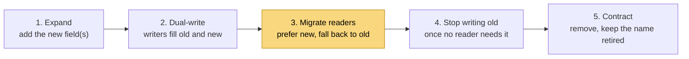

# 3. Expand and contract

Assumes [file 01](01-the-installed-client-problem.md) and
[file 02](02-consuming-payloads-you-dont-control.md). File 01 ended on a rule: the
safe way to change a field is to add a new one. This chapter is the procedure that
rule implies, and the ways it goes wrong when a step is skipped.

## The problem: a field that changed underneath its readers

Two versions of the same failure.

In the first, a field quietly started carrying two meanings. A subscription's
`expiresAt` held the trial end for trial accounts and the billing-period end for
paid ones, chosen by a rule inside the producer that no consumer could see. Every
reader that assumed one meaning was right for some records and wrong for others,
and nothing in the schema hinted at it.

In the second, an upstream stopped filling a field. A renewal rule parsed that
field, hit a parse error, logged it and returned early. The rule didn't fail; it
simply never fired again, for anyone. A warning that should have gone to every
affected customer went to none, and the only trace was a log line nobody was
alerting on.

Both have the same root cause: a field's meaning or availability changed **in
place**, so every reader inherited the change at once, without being asked.

## The pattern: never change a field, replace it

The fix has a name. Danilo Sato's
[Parallel Change](https://martinfowler.com/bliki/ParallelChange.html) (2014)
describes it as "a pattern to implement backward-incompatible changes to an
interface in a safe manner", also known as **expand and contract**, in three
phases:

> **Expand:** you augment the interface to support both the old and the new
> versions.
>
> **Migrate:** you update all clients using the old version to the new version.
>
> **Contract:** remove the old version and change the interface so that it only
> supports the new version.

Google's [AIP-180](https://google.aip.dev/180) reaches the same place from the
rules side: "Renaming a component is semantically equivalent to 'remove and
add'", so "a service may add the new component, but must not remove the existing
one."

For a field in a payload, the migrate phase splits into steps you can ship one at
a time:



| Phase | Writers | Readers | If you roll back |
|---|---|---|---|
| 1. Expand | schema has both; still write only old | read old | nothing to undo |
| 2. Dual-write | write both, from the same source of truth | read old | old field still complete |
| 3. Migrate readers | write both | prefer new, fall back to old, **count fallbacks** | old field still complete |
| 4. Stop writing old | write new only | read new | readers you missed now see absent |
| 5. Contract | — | — | name stays retired forever |

Step 3 is the one that takes the time and the one people skip, which is why it's
highlighted. Steps 1 and 2 are mechanical. Step 4 is only safe once you know
nobody reads the old field, and the fallback counter from step 3 is how you know.

**One meaning per field.** When the problem is a conflated field, the expand step
adds one new field per meaning — `trialEndsAt` and `periodEndsAt` — never one new
field with the same ambiguity under a better name. The old field stays exactly as
it was, ambiguity included, until it's gone: "fixing" it in place is the very
mistake you are recovering from.

```go
type Subscription struct {
	Plan string `json:"plan"`

	// Deprecated: meant the trial end for trial plans and the period end for
	// paid plans. Read TrialEndsAt or PeriodEndsAt. Still written until every
	// reader has moved; never reuse the name for something else.
	ExpiresAt *time.Time `json:"expiresAt,omitempty"`

	TrialEndsAt  *time.Time `json:"trialEndsAt,omitempty"`
	PeriodEndsAt *time.Time `json:"periodEndsAt,omitempty"`
}

var legacyReads = expvar.NewInt("subscription_expiresAt_legacy_reads")

// periodEnd prefers the new field and falls back to the old one only where
// the old one meant the same thing.
func periodEnd(s Subscription) (time.Time, bool) {
	if s.PeriodEndsAt != nil {
		return *s.PeriodEndsAt, true
	}
	if s.ExpiresAt != nil && s.Plan == "paid" {
		legacyReads.Add(1) // when this stays at zero, the old field can go
		return *s.ExpiresAt, true
	}
	return time.Time{}, false
}

type Verdict int

const (
	CannotEvaluate Verdict = iota // the zero value is the visible one
	OK
	RenewalDue
)

var cannotEvaluate = expvar.NewInt("renewal_check_cannot_evaluate")

func renewalCheck(s Subscription, now time.Time) Verdict {
	end, ok := periodEnd(s)
	if !ok {
		cannotEvaluate.Add(1) // not a silent return: an outcome you can alert on
		return CannotEvaluate
	}
	if end.Sub(now) < 30*24*time.Hour {
		return RenewalDue
	}
	return OK
}
```

<details>
<summary>Rust version</summary>

```rust
use std::sync::atomic::{AtomicU64, Ordering};

#[derive(serde::Deserialize)]
#[serde(rename_all = "camelCase")]
struct Subscription {
    plan: String,
    /// Deprecated: trial end for trial plans, period end for paid plans.
    expires_at: Option<i64>, // Unix seconds
    trial_ends_at: Option<i64>,
    period_ends_at: Option<i64>,
}

static LEGACY_READS: AtomicU64 = AtomicU64::new(0);
static CANNOT_EVALUATE: AtomicU64 = AtomicU64::new(0);

fn period_end(s: &Subscription) -> Option<i64> {
    if let Some(t) = s.period_ends_at {
        return Some(t);
    }
    match s.expires_at {
        Some(t) if s.plan == "paid" => {
            LEGACY_READS.fetch_add(1, Ordering::Relaxed);
            Some(t)
        }
        _ => None,
    }
}

#[derive(Debug, PartialEq)]
enum Verdict { CannotEvaluate, Ok, RenewalDue }

fn renewal_check(s: &Subscription, now: i64) -> Verdict {
    match period_end(s) {
        None => {
            CANNOT_EVALUATE.fetch_add(1, Ordering::Relaxed);
            Verdict::CannotEvaluate
        }
        Some(end) if end - now < 30 * 24 * 3600 => Verdict::RenewalDue,
        Some(_) => Verdict::Ok,
    }
}
```

</details>

<details>
<summary>C++ version</summary>

```cpp
#include <atomic>
#include <optional>
#include <string>

struct Subscription {
    std::string plan;
    std::optional<long long> expires_at;      // deprecated; Unix seconds
    std::optional<long long> trial_ends_at;
    std::optional<long long> period_ends_at;
};

std::atomic<long> legacy_reads{0}, cannot_evaluate{0};

std::optional<long long> period_end(const Subscription& s) {
    if (s.period_ends_at) return s.period_ends_at;
    if (s.expires_at && s.plan == "paid") { ++legacy_reads; return s.expires_at; }
    return std::nullopt;
}

enum class Verdict { CannotEvaluate, Ok, RenewalDue };

Verdict renewal_check(const Subscription& s, long long now) {
    auto end = period_end(s);
    if (!end) { ++cannot_evaluate; return Verdict::CannotEvaluate; }
    return (*end - now < 30LL * 24 * 3600) ? Verdict::RenewalDue : Verdict::Ok;
}
```

</details>

<details>
<summary>JavaScript version</summary>

```js
const counters = { legacyReads: 0, cannotEvaluate: 0 };

function periodEnd(s) {
  if (s.periodEndsAt != null) return new Date(s.periodEndsAt);
  if (s.expiresAt != null && s.plan === "paid") {
    counters.legacyReads++;
    return new Date(s.expiresAt);
  }
  return null;
}

function renewalCheck(s, now) {
  const end = periodEnd(s);
  if (end === null || Number.isNaN(end.getTime())) {
    counters.cannotEvaluate++;
    return "cannot-evaluate";
  }
  return end - now < 30 * 24 * 3600 * 1000 ? "renewal-due" : "ok";
}
```

</details>

## Deprecation includes a reader audit

The second failure at the top of this chapter happened to a team that did nothing
wrong in the producer. The upstream stopped filling a field; they hadn't written
it, so they hadn't thought of themselves as party to its removal. But every reader
of a field is party to its removal, and a reader you didn't find is a rule that
switches itself off.

The dangerous shape is specific: **parse, and on error log and return early.** It
looks defensive. What it does is convert "field missing" into "rule didn't apply",
which is indistinguishable from "rule applied and found nothing". That's why the
renewal check above returns `CannotEvaluate` and counts it instead.

So before a field stops being written — by you, or by an upstream that told you
it will — search for every reader, and search wider than the service in front of
you:

| Where readers hide | Why it gets missed |
|---|---|
| Business rules and validators | the obvious place, and the only one people search |
| A second code path that builds the same response | a projection or mapping duplicated "temporarily" |
| Templates, reports and exports | they read by string key, often with a silent default |
| Frontends and SDKs in other languages | a different repository and a different language |
| Database columns, queries and views | the field was persisted, so the data outlives the writer |
| Allowlists, form schemas and response templates | the field is registered by name in a list somewhere |
| Dashboards and alert rules | a metric or log query that filters on the field |

The table is a checklist precisely because the cost of missing one row isn't an
error. It's an empty value, or a rule that has stopped running.

## Renaming an enum value

Changing the spelling of an enum value — a role `ADMIN` becoming `ORG_ADMIN`, say
— is a rename, so AIP-180's "remove and add" applies. The order matters, and it's
easy to get backwards:

1. **Readers accept both** the old and the new value. This is the expand step.
2. **Writers switch** to the new value. Safe now, because every reader accepts it.
3. **Readers drop the old value**, once nothing sends it.

"Change the writers first" is only half right. It is right relative to step 3 —
you can't stop accepting the old value while something still sends it. But it is
wrong as the first move if any reader validates strictly against the enum, because
a strict reader that has never heard of `ORG_ADMIN` rejects it. Tightening a
request schema's enum and renaming a value in the same release is the worst of
both: every caller still sending the old name now gets a validation error.

Where a value travels in both directions — a role that appears in requests and in
a token the server issues — each side is a reader *and* a writer, and each needs
step 1 before the other does step 2.

## Expand and contract in a database

The same pattern is standard for database schema changes, and the shared name
causes confusion, because the constraints differ.

| | Payload field | Database column |
|---|---|---|
| Who the old readers are | clients and services you may not control | your own application instances during a rolling deploy, plus anything else that queries the table |
| How long old readers live | for installed clients, indefinitely | usually minutes to hours, the length of the rollout |
| What "contract" does | stop writing; keep the name retired | `DROP COLUMN`: the data is gone |
| Can you undo contract? | yes, start writing again | only from a backup; a down migration recreates an empty column |

The database version has one trap of its own. Put the code change and the
`DROP COLUMN` in the same release, and the instances still running the old code
during the rollout query a column that no longer exists. The drop belongs in a
later release than the code that stopped reading it. Marking the column
deprecated and dropping it in the same migration documents nothing, because the
comment and the column vanish together.

## Events: carry facts, and default to the old behaviour

Events add a twist, because the producer and consumer deploy independently and
neither waits for the other.

**Carry facts, not verdicts.** Say a job-processing service emits `job.finished`,
and a billing service charges for it unless the job failed in certain ways. If the
producer sends `billable: false`, it has copied the billing policy into a service
that doesn't own it, and every policy change now needs both teams. If it sends the
facts — the terminal state and the error codes — the billing service applies its
own rule and can change it alone.

**Emit only when the facts are final.** An event emitted at an intermediate
milestone, with the outcome hard-coded to "completed" and no errors because none
had happened *yet*, isn't carrying facts. The consumer will apply a perfectly
correct policy to an outcome that never occurred: jobs that later failed get
billed as successes. Emit from the terminal state, with the real outcome, from one
place that every exit path goes through.

**Give the new field a default that means "as before".** That is what lets either
side deploy first. Confluent's
[schema evolution guide](https://docs.confluent.io/platform/current/schema-registry/fundamentals/schema-evolution.html)
frames it as compatibility modes: with BACKWARD compatibility "upgrade all
consumers before you start producing new events"; with FORWARD, "first upgrade
all producers"; with FULL, "you can upgrade the producers and consumers
independently". For an added field, the matrix is:

| | Old consumer | New consumer |
|---|---|---|
| **Old producer** | today | field absent: the consumer must fall back to the old behaviour |
| **New producer** | consumer ignores the unknown field (file 02's tolerant reader) | the target |

The bottom-left cell needs a tolerant consumer. The top-right cell needs a default
that reproduces yesterday. Get both and the deploy order stops mattering, which is
the FULL case.

The choice of field decides whether the top-right default comes for free. A list
of error codes defaults to "no codes", which is what the consumer assumed before
the field existed. A verdict flag does not: in Go, an absent `bool` decodes as
`false` (file 02), so an old producer talking to a new consumer would mark every
job non-billable.

```go
type JobFinished struct {
	JobID string `json:"jobId"`
	State string `json:"state"` // terminal states only

	// Added later. Absent (old producer) decodes as nil: no codes, which is
	// exactly what the consumer assumed before the field existed.
	ErrorCodes []string `json:"errorCodes,omitempty"`
}

// For contrast, the verdict version needs a pointer to survive an old
// producer: nil must mean "use the old rule", not "false".
type JobFinishedVerdict struct {
	JobID    string `json:"jobId"`
	Billable *bool  `json:"billable,omitempty"`
}
```

<details>
<summary>Rust version</summary>

```rust
#[derive(serde::Deserialize)]
#[serde(rename_all = "camelCase")]
struct JobFinished {
    job_id: String,
    state: String,
    #[serde(default)] // absent -> empty Vec: the old behaviour
    error_codes: Vec<String>,
}

#[derive(serde::Deserialize)]
#[serde(rename_all = "camelCase")]
struct JobFinishedVerdict {
    job_id: String,
    billable: Option<bool>, // None must mean "use the old rule"
}
```

</details>

<details>
<summary>C++ version (nlohmann/json)</summary>

```cpp
#include <optional>
#include <string>
#include <vector>
#include <nlohmann/json.hpp>

struct JobFinished {
    std::string job_id, state;
    std::vector<std::string> error_codes;  // absent -> empty: the old behaviour
};

JobFinished parse_job_finished(const nlohmann::json& j) {
    return {
        j.at("jobId").get<std::string>(),
        j.at("state").get<std::string>(),
        j.value("errorCodes", std::vector<std::string>{}),
    };
}

// The verdict version: std::nullopt must mean "use the old rule".
std::optional<bool> billable(const nlohmann::json& j) {
    if (!j.contains("billable") || j["billable"].is_null()) return std::nullopt;
    return j["billable"].get<bool>();
}
```

</details>

<details>
<summary>JavaScript version</summary>

```js
function parseJobFinished(msg) {
  return {
    jobId: msg.jobId,
    state: msg.state,
    errorCodes: msg.errorCodes ?? [], // absent -> empty: the old behaviour
  };
}

// The verdict version: undefined must mean "use the old rule", never false.
const billable = (msg) => (typeof msg.billable === "boolean" ? msg.billable : undefined);
```

</details>

> **Teacher's aside.** People hear "expand and contract" as a migration technique
> and reach for it only when a change is obviously breaking. The more useful
> reading is that **there is no such thing as changing a field.** There is adding
> a field, and there is removing one, and everything that feels like a change —
> a rename, a new meaning, a split, a type change, a new enum spelling — is both,
> separated in time by however long it takes the last reader to move. The work is
> in that gap, and the gap is where the reader audit and the fallback counter
> live.

## Check yourself

1. A field `amount` has always held a value in pounds. A new product line needs
   pence, and someone proposes adding a `currencyUnit` field that says which one
   `amount` holds. Why is that worse than it looks, and what would expand and
   contract do instead?
2. You are at step 3, migrating readers. How do you know when it's safe to move
   to step 4, and what does it cost you if you guess?
3. An upstream announces it will stop sending a field next month. Your service
   never writes that field. List what you would do before the date, and explain
   why "we don't write it, so we're not affected" is wrong.
4. A team renames an enum value and, in the same release, changes the request
   validator from "any string" to "one of the listed values". Callers start
   getting validation errors. Which step of the rename did they skip, and what
   order would have worked?
5. A producer adds `retryable: bool` to a failure event, and the consumer starts
   retrying only when it's true. The consumer ships first. What happens to every
   failure until the producer ships, and how would you change the field so the
   deploy order doesn't matter?
6. A migration in one release removes the code that reads a column and drops the
   column. The deploy is a rolling update across ten instances. Describe the
   failure during the rollout, and what a rollback would and wouldn't restore.
