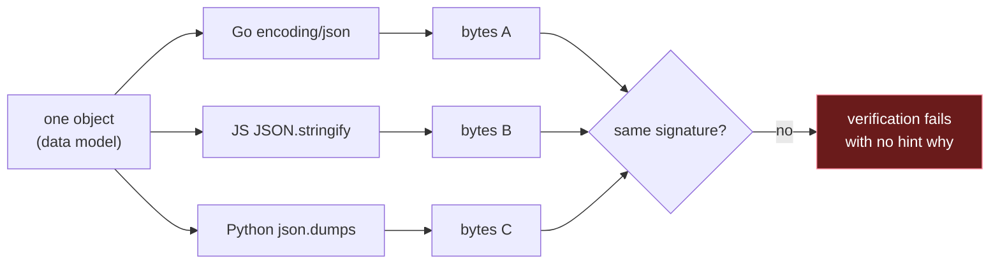

# 6. Signing JSON across languages

**Assumes** [file 01](01-foundations.md) (what a signature proves) and the "exact bytes" lesson
from [file 04 §4.7](04-signing-in-automation.md). Nothing in this chapter is SSH-specific.

## 6.1 The problem

Two services, written in different languages, both "sign the same JSON". The signer's
signatures verify in the signer's own tests. In the other service they fail — sometimes on
every message, sometimes only on messages containing an ampersand, an accented name or a
price like `1.0`, and sometimes on roughly half of all messages at random.

Nothing is wrong with the cryptography. The mistake is in the phrase "the same JSON".
[File 01 §1.6](01-foundations.md) put it narrowly: a signature proves someone signed
**exactly these bytes**. JSON is not bytes. It's a data model — objects, arrays, strings,
numbers — and every data value has many valid byte spellings. When two services say "same
JSON" they mean the same data. The signature checks the spelling.

So every cross-language JSON signature scheme has to answer one question before anything
else: **which bytes, exactly, are signed, and how does the verifier get the same ones?**



## 6.2 One object, three spellings

Here's one input document, parsed and re-serialised by each language's standard library
with its defaults (Go 1.24.4, Node 26, CPython 3, run locally):

```
input:          {"z":1,"a":"<b>Tom & Jerry</b>","name":"Zoë","amount":1.0,"big":12345678901234567890}

Go Marshal:     {"a":"<b>Tom & Jerry</b>","amount":1,"big":12345678901234567000,"name":"Zoë","z":1}
JSON.stringify: {"z":1,"a":"<b>Tom & Jerry</b>","name":"Zoë","amount":1,"big":12345678901234567000}
json.dumps:     {"z": 1, "a": "<b>Tom & Jerry</b>", "name": "Zoë", "amount": 1.0, "big": 12345678901234567890}
```

Three libraries, three different byte strings, every one of them correct JSON for the same
data. Each difference is a documented default:

| Trap | Go `encoding/json` | JS `JSON.stringify` | Python `json.dumps` (defaults) |
|---|---|---|---|
| **Object key order** | Map keys sorted ("The map keys are sorted"). Struct fields came out in declaration order in my test; the docs don't promise it | The `Object.keys()` order: integer-like keys ascending, then the rest in insertion order. `{b, 2, a, 1}` → `{"1","2","b","a"}` | Insertion order ("encoders and decoders preserve input and output order by default"); `sort_keys=False` |
| **HTML characters** `< > &` | Escaped to `< > &` (also U+2028, U+2029). Off with `Encoder.SetEscapeHTML(false)` | Emitted as-is | Emitted as-is |
| **Non-ASCII** (`ë`) | Emitted as UTF-8 | Emitted as UTF-8 | Escaped to `ë`: `ensure_ascii=True` is the default |
| **Whitespace** | None | None | `", "` and `": "` — separators default to those when `indent` is `None` |
| **`1.0`** | `1` (decoded to `float64`) | `1` (a JS number) | `1.0` (stays a Python `float`) |
| **Integers above 2⁵³** | Rounded: generic decoding gives `float64` unless you use `Decoder.UseNumber` | Rounded: every JS number is a double | Exact: Python `int` is arbitrary precision |
| **Trailing newline** | `Marshal` adds none; `Encoder.Encode` appends `\n` | None | None |

Sources: [Go `encoding/json`](https://pkg.go.dev/encoding/json),
[MDN `JSON.stringify`](https://developer.mozilla.org/en-US/docs/Web/JavaScript/Reference/Global_Objects/JSON/stringify),
[Python `json`](https://docs.python.org/3/library/json.html). The outputs above are the
real ones; the table only explains them.

Two things make this nastier than it looks.

**It fails selectively.** A test payload of plain ASCII letters and small integers can
serialise identically in all three. The first `&`, the first accented surname, the first
amount that happens to be a whole number written as `1.0` breaks it, in production, on some
records only.

**"Sort the keys on both sides" is not a fix.** It's the most common attempt, and it removes
one row of that table. Escaping, whitespace, number spelling and big integers remain. And
in Go, sorting a map before marshalling is a no-op — `Marshal` already sorts map keys — which
is a sign the author was reasoning about the data, not the bytes.

## 6.3 Three ways out

There are three sound designs. Everything else is a fourth, unsound one: "both sides
serialise with whatever their library does and hope".

### 6.3.1 Sign the bytes you send, and send those bytes

The simplest fix avoids the problem entirely. **Serialise once, sign those bytes, ship
those exact bytes**, with the signature beside them rather than inside them (a header, a
sibling field holding the payload as a string, a separate file). The verifier checks the
signature over the raw bytes it received **before parsing anything**, and never
re-serialises.

```go
// Signer: serialise once, sign exactly those bytes.
func signBody(priv ed25519.PrivateKey, v any) (body []byte, sigB64 string, err error) {
	body, err = json.Marshal(v) // serialise once
	if err != nil {
		return nil, "", err
	}
	sig := ed25519.Sign(priv, body) // sign those exact bytes
	return body, base64.StdEncoding.EncodeToString(sig), nil
}

// Verifier: check the raw bytes first; parse only if they verify.
func verifyBody(pub ed25519.PublicKey, body []byte, sigB64 string, out any) error {
	sig, err := base64.StdEncoding.DecodeString(sigB64)
	if err != nil || !ed25519.Verify(pub, body, sig) {
		return errBadSignature
	}
	return json.Unmarshal(body, out) // parse only after verifying
}
```

The signer sends `body` as the HTTP body and `sigB64` in a header of your choosing (say
`Body-Signature`). The verifier must read the body as raw bytes — `io.ReadAll`, a `Buffer`,
a `&[u8]` — not through a framework that hands you an already-parsed object.

All four versions here were run against each other: a Go-signed body verified in Go, Node,
Rust (`ed25519-dalek` 2.2) and C++ (libsodium), and a one-byte change failed in each.

<details>
<summary>JavaScript (Node) verifier</summary>

```js
import { createPublicKey, verify } from "node:crypto";

// Raw 32-byte Ed25519 public key wrapped in the SPKI DER prefix Node expects.
const SPKI_PREFIX = Buffer.from("302a300506032b6570032100", "hex");

function verifyBody(pubRaw, body, sigB64) {   // body is a Buffer: the exact bytes
  const key = createPublicKey({
    key: Buffer.concat([SPKI_PREFIX, pubRaw]), format: "der", type: "spki",
  });
  const ok = verify(null, body, key, Buffer.from(sigB64, "base64")); // null algorithm for Ed25519
  if (!ok) throw new Error("bad signature");
  return JSON.parse(body.toString("utf8"));    // parse only after verifying
}
```

</details>

<details>
<summary>Rust verifier (ed25519-dalek 2, base64 0.22, serde_json)</summary>

```rust
use base64::{engine::general_purpose::STANDARD, Engine};
use ed25519_dalek::{Signature, Verifier, VerifyingKey};

fn verify_body(pub_raw: &[u8; 32], body: &[u8], sig_b64: &str) -> Result<serde_json::Value, String> {
    let key = VerifyingKey::from_bytes(pub_raw).map_err(|e| e.to_string())?;
    let sig_bytes: [u8; 64] = STANDARD
        .decode(sig_b64.trim())
        .map_err(|e| e.to_string())?
        .try_into()
        .map_err(|_| "signature must be 64 bytes".to_string())?;
    key.verify(body, &Signature::from_bytes(&sig_bytes))
        .map_err(|_| "bad signature".to_string())?;
    serde_json::from_slice(body).map_err(|e| e.to_string()) // parse only after verifying
}
```

</details>

<details>
<summary>C++ verifier (libsodium)</summary>

```cpp
#include <sodium.h>   // call sodium_init() once at startup
#include <string>
#include <vector>

// True only if sig_b64 decodes to a valid Ed25519 signature over exactly `body`.
bool verify_body(const unsigned char pub[crypto_sign_PUBLICKEYBYTES],
                 const std::vector<unsigned char>& body,
                 const std::string& sig_b64) {
    unsigned char sig[crypto_sign_BYTES];
    size_t sig_len = 0;
    if (sodium_base642bin(sig, sizeof sig, sig_b64.data(), sig_b64.size(),
                          "\n", &sig_len, nullptr, sodium_base64_VARIANT_ORIGINAL) != 0
        || sig_len != crypto_sign_BYTES) {
        return false;
    }
    return crypto_sign_verify_detached(sig, body.data(), body.size(), pub) == 0;
}
```

</details>

The weakness is anything in between that re-encodes the body: a proxy that recompresses or
pretty-prints, a framework that parses the request and re-serialises it for your handler, a
logging middleware that "normalises" JSON. The fix is the same as in
[file 04 §4.7](04-signing-in-automation.md): treat the payload as opaque bytes until the
signature has been checked.

For HTTP specifically there's a standard for this shape: **RFC 9421, HTTP Message
Signatures** (Proposed Standard, February 2024), which defines `Signature-Input` and
`Signature` fields. It deliberately doesn't sign the body directly — it says it "does not
define a means to directly cover HTTP message content" — and instead points you at
covering a `Content-Digest` field ([RFC 9530](https://www.rfc-editor.org/rfc/rfc9530)),
which holds a hash of the body bytes. Same principle: hash and sign the bytes, not the data.

### 6.3.2 Use a format whose payload is bytes: JWS

**JSON Web Signature** ([RFC 7515](https://www.rfc-editor.org/rfc/rfc7515)) builds §6.3.1
into a standard. Its payload is defined as "an arbitrary sequence of octets" (§2), and in
the common compact form it travels base64url-encoded inside the token. What gets signed is

```
ASCII( BASE64URL(UTF8(protected header)) || '.' || BASE64URL(payload) )
```

Base64url, like base64 ([file 01 §1.2](01-foundations.md)), survives any amount of JSON
re-serialisation around it, so the exact payload bytes reach the verifier. You verify, then
decode, then parse. No canonical form is needed, because nobody ever re-creates the payload
bytes from data.

Two extensions are worth knowing:

| Need | Mechanism |
|---|---|
| Don't want a copy of the payload inside the token | **Detached content**, RFC 7515 Appendix F: blank the payload field and send it separately; it "assumes that the recipient can reconstruct the exact payload used in the JWS" |
| Don't want the payload base64url-encoded (large bodies, or signing a body sent as-is) | **Unencoded payload**, [RFC 7797](https://www.rfc-editor.org/rfc/rfc7797): header `"b64": false`, which "MUST" also be listed in `"crit"` so a verifier that doesn't understand it refuses rather than misreads. The signing input becomes `ASCII(BASE64URL(UTF8(header)) \|\| '.') \|\| payload`. Payloads containing `.` "MUST NOT be used with the JWS Compact Serialization" unless detached |

A detached, unencoded JWS is essentially §6.3.1 with a standard header describing the
algorithm and key. Using a JWS library also settles the signature's own byte format
(§6.4), which hand-rolled schemes routinely get wrong.

### 6.3.3 Canonicalise: JCS (RFC 8785)

Sometimes you can't ship the bytes — the signature has to live *inside* the JSON object it
signs, or the document gets stored, queried and re-emitted by systems that will
re-serialise it. Then both sides must reconstruct the same bytes from the data, which needs
a **canonical form**: one specified spelling per value.

The published one is the **JSON Canonicalization Scheme**,
[RFC 8785](https://www.rfc-editor.org/rfc/rfc8785):

| Rule | RFC 8785 |
|---|---|
| No whitespace between tokens | §3.2.1 "MUST NOT be emitted" |
| Strings: escape only `"`, `\` and U+0000–U+001F; everything else as-is. Lone surrogates are an error | §3.2.2.2, following ECMA-262's `JSON.stringify` rules |
| Numbers: the ECMAScript number-to-string algorithm (so `1.0` → `1`); NaN and Infinity are errors | §3.2.2.3, ECMA-262 §7.1.12.1 |
| Object members sorted by key, comparing **UTF-16 code units** as unsigned numbers, no locale | §3.2.3 |
| Output encoded as UTF-8 | §3.2.4 |
| Input must be I-JSON (RFC 7493): no duplicate keys, numbers representable as IEEE 754 doubles | §3.1 |
| Numbers that don't fit a double "MUST be wrapped using the JSON string type" | Appendix D |

Notice the design choice: JCS adopts JavaScript's primitive serialisation wholesale, so a JS
implementation is little more than a recursive key sort around `JSON.stringify`. Every
other language has to emulate ECMAScript number formatting exactly, which is the hard part
— the RFC's Appendix B is a table of number test cases for exactly that reason, and
Appendix G lists implementations verified compatible (JavaScript, Java, Go, .NET, Python).

Things to be honest about:

- **RFC 8785 is Informational**, not Standards Track. It's the one people point at, not a
  mandate.
- **"Sort keys and stringify" isn't JCS** outside JavaScript. A Go or Python
  implementation that sorts keys but keeps its own escaping or number formatting produces
  something that looks canonical and isn't.
- **Big integers must already be strings in your schema.** JCS won't rescue an ID like
  `12345678901234567890` sent as a number; one side has already rounded it before
  canonicalisation runs (§6.2's last-but-one row).
- **Sorting by UTF-16 code units** differs from sorting by UTF-8 bytes or by code points
  once keys contain characters outside the Basic Multilingual Plane. Keys are usually
  ASCII, and then it doesn't matter; if yours aren't, use a JCS library rather than a sort.

| | Ship the bytes (§6.3.1) | JWS (§6.3.2) | Canonicalise (§6.3.3) |
|---|---|---|---|
| Verifier needs a canonicaliser | No | No | Yes, byte-exact in every language |
| Survives re-serialisation in transit | No — anything between must leave bytes alone | Yes (compact form is a string) | Yes |
| Signature can sit inside the object | No | No (it wraps the payload) | Yes (remove it, canonicalise, verify) |
| Standard | RFC 9421 + RFC 9530 for HTTP | RFC 7515, 7797 | RFC 8785 (Informational) |
| Typical failure | Middleware re-encodes the body | Wrong library API, wrong `alg` handling | One implementation isn't really JCS |

> **Teacher's aside.** People think of canonicalisation as a detail inside a signing scheme.
> It's the other way round: **the canonical form is the protocol**, and the signature is a
> detail. If two teams agree "secp256k1 over SHA-256 of the sorted JSON" they've agreed on
> the easy half. The part that decides whether verification works — which bytes — has been
> left to whatever each language's serialiser does by default, and those defaults were
> chosen for readability, HTML safety and backwards compatibility, never for byte-equality
> across languages. Prefer the designs where no one has to reproduce bytes at all.

## 6.4 The signature has a byte format too

Even with identical message bytes, the *signature* bytes can fail to cross a language
boundary. Ed25519 defines a single signature format, 64 bytes
([RFC 8032](https://www.rfc-editor.org/rfc/rfc8032)), which is one reason to prefer it. ECDSA doesn't. Its output is mathematically a pair of
integers `(r, s)` ([SEC 1 v2 §4.1](https://www.secg.org/sec1-v2.pdf)), and libraries
disagree about how to write that pair down:

| Encoding | Shape | Who uses it |
|---|---|---|
| **DER** | ASN.1 `SEQUENCE { r INTEGER, s INTEGER }` — variable length, because DER integers drop leading zeros and add a sign byte | X.509 ([RFC 3279 §2.2.3](https://www.rfc-editor.org/rfc/rfc3279#section-2.2.3)), OpenSSL's default, Go's `ecdsa.SignASN1` ("returns the ASN.1 encoded signature") |
| **Raw `r‖s`** (IEEE P1363) | Two fixed-length big-endian integers concatenated: 64 bytes for a 256-bit curve | JWS ES256 ([RFC 7518 §3.4](https://www.rfc-editor.org/rfc/rfc7518#section-3.4): each 32 octets, "MUST NOT be shortened to omit any leading zero octets"); WebCrypto `sign()` ([MDN](https://developer.mozilla.org/en-US/docs/Web/API/SubtleCrypto/sign)); libsecp256k1's "compact" format |
| **`r‖s‖v`** | Raw `r‖s` plus one recovery byte, 65 bytes, letting a verifier recover the public key | Ethereum-style secp256k1 libraries; go-ethereum's `crypto.Sign` returns "[R ‖ S ‖ V] format where V is 0 or 1", while its `VerifySignature` wants "the 64 byte [R ‖ S] format" |

And two more traps that only appear at the boundary:

- **Who hashes.** WebCrypto's ECDSA `sign()` takes the message and hashes it with the hash
  you name. Go's `ecdsa.SignASN1` takes an already-computed hash. Wire one to the other
  without noticing and one side signs `H(m)` while the other verifies `H(H(m))`.
- **Low-S.** For any valid ECDSA signature `(r, s)`, `(r, n − s)` is also valid — anyone can
  flip it without the key. libsecp256k1 refuses the "high" half: "To avoid accepting
  malleable signatures, only ECDSA signatures in lower-S form are accepted"
  ([`secp256k1.h`](https://github.com/bitcoin-core/secp256k1/blob/master/include/secp256k1.h)).
  A signer whose library doesn't normalise to low-S will, by my reasoning rather than a
  measurement, produce a high-S signature about half the time, since `s` comes out
  essentially uniform. That's the "half of all messages fail, at random" symptom from §6.1.

> ⚠️ A 64-byte versus 65-byte mismatch, or DER versus raw, usually shows up as "invalid
> signature", not "wrong format". Before debugging the payload, print the signature length
> on both sides. Raw is exactly 64 bytes for a 256-bit curve. DER varies: in 20,000 P-256
> signatures from Go's `ecdsa.SignASN1` I got 70, 71 or 72 bytes in all but 40 cases
> (69 or 68 when `r` or `s` happened to have leading zero bytes) — never 64 or 65.

## 6.5 Test vectors are the contract

Prose specs drift; fixtures don't. Whatever design you pick, publish **test vectors** —
files both implementations run in CI:

| Field | Why |
|---|---|
| Input data, as the producer holds it | What each side starts from |
| The exact signed bytes (hex or base64) | Pins serialisation; a diff here is a canonicalisation bug |
| The digest, if a separate hash step exists | Pins the hash function and "who hashes" |
| Public key, and signature bytes | Pins the signature encoding |
| Expected result: valid / invalid | Negative cases matter as much as positive ones |

Include the cases from §6.2 deliberately: `&`, `<`, a non-ASCII name, a right-to-left
string, `1.0`, an integer above 2⁵³ (as a string, if you follow JCS), nested objects, an
empty object, and — for ECDSA — a high-S signature, so you learn what the verifier does
with one before production does.

With a deterministic scheme (Ed25519, or ECDSA per RFC 6979) the vectors can pin the
signature bytes themselves; with randomised ECDSA they can only pin "this verifies".

## 6.6 Where signing sits, and what happens when it can't

Three operational rules decide whether a correct scheme stays correct.

**Sign last.** If the response passes through formatters, envelope builders or
compression after the signing step, the signature covers something nobody receives. A
classic version: each handler signs its own result object, and a later hook wraps or
reformats it — so some signatures cover the wrong object entirely. Sign in the last step
before the bytes go out (a framework's final "on send" hook, not inside handlers), and
verify-before-publish as in [file 04 §4.5](04-signing-in-automation.md).

**Keys come from a secret store.** Never in source, and never as a "sample" value in an
example config file — a key in git history is a published key. [File 04 §4.3](04-signing-in-automation.md)
covers CI secrets; the same applies to a service's runtime key.

**Make "unsigned" an explicit mode, or don't have one.** A service that can't load its key
can refuse to start, or it can carry on and send unsigned responses. The second is
sometimes reasonable (local development, a staged rollout), but done silently it's a
disaster with no symptoms: a typo in a secret name removes integrity protection and every
test still passes. If you allow it:

| Do | Why |
|---|---|
| Choose the mode explicitly in config (`signing: required` / `disabled`), never as a side effect of a missing key | A missing key in `required` mode is a startup failure, which someone notices |
| Log it at startup and export it as a metric, with an alert in production | The degraded state becomes visible |
| Make verifiers treat a **missing** signature as a failure, not as "nothing to check" | Otherwise stripping the signature field is a downgrade attack: no signature, no check, accepted |

---

## Check yourself

1. A Go service signs `json.Marshal(m)` for a `map[string]any`. A Node verifier does
   `JSON.stringify(JSON.parse(body))` and verifies that. Messages with only ASCII letters
   and numbers verify; one containing `Tom & Jerry` fails. Explain the failure byte by
   byte. Then the Go side switches from the map to a struct declared with fields `Zeta`
   then `Alpha`, so its output is no longer sorted. Does key order now break this verifier
   too? Why or why not — and what change on the verifier side *would* make it break?
2. A teammate fixes it by "sorting keys recursively on both sides". Name three inputs that
   still produce different bytes between Go, Node and Python defaults, and say which
   setting causes each.
3. In the ship-the-bytes design (§6.3.1), why does the verifier need no canonicaliser at
   all? Name two components that could still break verification, and what each does to the
   bytes.
4. A JCS-based scheme works for months, then fails on one customer whose account ID is
   `12345678901234567890`. Which side changed the data, at what step, and why can't
   canonicalisation fix it? What does RFC 8785 tell you to do instead?
5. Your verifier uses libsecp256k1 and expects 64-byte compact signatures. The signer uses
   a different library. About half the signatures fail, apparently at random, and the ones
   that fail fail consistently on retry. Give the most likely cause, why "half", and a fix
   on each side. What would a consistent 100% failure with 65-byte signatures point to
   instead?
6. A service falls back to unsigned responses when its key fails to load, and verifiers
   skip verification when the signature field is absent. Describe how an attacker who can
   modify responses in transit exploits this without any key, and the two changes that
   close it.

(Answers in [`08-exercises.md`](08-exercises.md).)
