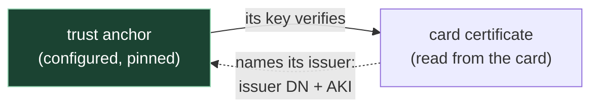

# 7. Verifying the card's certificate

Assumes [chapter 6](06-proving-genuineness.md) — in particular §The trap that catches all
three, which is where "chain it to a trust anchor" first appears.

## The problem

Chapter 6 ended on a rule: a certificate read off a card means nothing until it chains to a
CA you obtained out of band. That sentence hides most of the actual work, and every part of
it fails in practice in a way that looks like something else:

- **Which certificate?** A card usually carries more than one.
- **What does "chains to" mean**, mechanically — what is checked, and what isn't?
- **Which CA?** A national issuer running for twenty years has several, all live at once.
- **Why does one library accept a certificate another refuses?**
- **Is a certificate that chained yesterday still good today?** That's revocation, and it
  has its own trust anchor.

This chapter takes them in that order. None of it is specific to smart cards — it's X.509
as RFC 5280 defines it — but a card is where all five meet in one place.

## What's on the card

A card with a PKI application holds one or more **key pairs**. Each private key is
non-exportable, which is chapter 6's whole point. Each public key is published in an
**X.509 certificate**, stored on the card as an ordinary readable file.

There are usually two, because the two jobs need different gates (chapter 6 §Which
credential gates which mechanism):

| Certificate | Its key is used to | Typically gated by |
|---|---|---|
| **Authentication** | sign a challenge to log in — "this is me, now" | a PIN |
| **Signing** | sign a document — "I agree to this" | a separate, stronger PIN |

Estonia's ID card is the textbook case: PIN1 unlocks the authentication key, PIN2 the
signing key ([id.ee](https://www.id.ee/en/article/on-the-safe-use-of-pins/)). The
difference shows up in the certificate as **key usage** (RFC 5280 §4.2.1.3): an
authentication certificate asserts `digitalSignature`; a signing certificate typically adds
`nonRepudiation`, which recent editions of X.509 rename `contentCommitment`.

A certificate is a signed statement by an issuer. The fields that matter here:

| Field | What it says | Used for |
|---|---|---|
| `subject` | whose key this is | binding the key to a person |
| `issuer` | the name of the CA that signed it (§4.1.2.4) | finding the CA |
| `serialNumber` | unique **per issuer**, not globally (§4.1.2.2) | revocation lookups |
| `validity` | `notBefore` … `notAfter` | expiry |
| `subjectPublicKeyInfo` | the public key | verifying what the card signs |
| `authorityKeyIdentifier` (AKI) | an identifier of the issuer's **key** (§4.2.1.1) | finding the CA when it has had several keys |
| `keyUsage` | what the key may be used for (§4.2.1.3) | refusing misuse |
| `signatureValue` | the issuer's signature over the DER bytes of everything above (§4.1.1.3) | the only thing that proves anything |

And on a **CA** certificate, two more:

| Field | What it says |
|---|---|
| `subjectKeyIdentifier` (SKI) | an identifier of this CA's own key — what a leaf's AKI points at (§4.2.1.2) |
| `basicConstraints` | `cA` — may this key sign certificates? — and `pathLenConstraint`, how many CAs may sit below it (§4.2.1.9) |

## What "chains to" means

RFC 5280 §6.1 defines **path validation**: given a path of certificates where the first
is issued by the trust anchor and each certificate's subject is the next one's issuer,
check every link. For each certificate in the path:

1. its signature verifies under the **issuer's** public key;
2. the current time is inside its validity period;
3. every CA certificate in the path is permitted to sign certificates — `cA` true and, where
   key usage is present, `keyCertSign` (§6.1.4);
4. no path-length or name constraint above it is exceeded.

eID chains are short. The card's certificate is often signed directly by the CA you anchor
on, or by one intermediate below it.

Read the input list carefully, because one thing is missing from it. §6.1 says "the trust
anchor is an input to the algorithm", and when it's supplied as a self-signed certificate,
"this self-signed certificate is not included as part of the prospective certification
path". Its own signature is never checked.

> **Teacher's aside.** People expect verification to check the root's self-signature, and
> it doesn't — OpenSSL skips it unless you pass `-check_ss_sig`, which its documentation
> describes as off by default because it adds no security
> ([openssl-verification-options](https://manpages.ubuntu.com/manpages/noble/man1/openssl-verification-options.1ssl.html)).
> Think about what a self-signature proves: that whoever made the file held the matching
> private key. Anyone can make a self-signed certificate with any name on it. What makes a
> certificate a trust anchor is that **you** put it in your trust store, and the thing that
> stops someone else putting a different one there is the **pin** — the fingerprint you
> check it against at load. Trust is configuration. That has a useful consequence later in
> this chapter.

## Which CA, when the issuer has several

A scheme that has issued cards for two decades does not have one CA. It has several, all
live at once:

- **Key changeover.** A CA key reaches the end of its life; a new one starts issuing; cards
  signed under the old one stay valid until they expire, often years later.
- **Generations.** A new card platform arrives with its own issuing CA.
- **Organisational change.** The authority is renamed, and the new CA carries the new name.

RFC 5280 anticipates exactly this: the AKI extension "is used where an issuer has multiple
signing keys (either due to multiple concurrent key pairs or due to changeover)" (§4.2.1.1).

So the verifier holds a **list** of anchors, and needs to find the right one for each card.
The card's certificate names its issuer twice:

| In the leaf | Contains | Matched against, in the CA | What it narrows |
|---|---|---|---|
| `issuer` | the CA's distinguished name | `subject` | which authority |
| `authorityKeyIdentifier` | an identifier of the signing key | `subjectKeyIdentifier` | which key, when one name has had several |

Then the signature check proves it. Go's verifier, for instance, takes the anchors whose
subject equals the leaf's issuer, puts the one whose key identifier matches first, and tries
signatures in that order (`findPotentialParents` in
[`crypto/x509/cert_pool.go`](https://github.com/golang/go/blob/master/src/crypto/x509/cert_pool.go)).
With the right anchor present, that's one signature check per card.

The lookup is a hint; the signature is the proof. A forged certificate can carry any issuer
name and any AKI it likes. It cannot carry a signature that verifies under the CA's key.

> ⚠️ **Same printed name, different bytes.** RFC 5280 §4.1.2.6 requires a CA to encode its
> subject exactly as it appears in the issuer field of every certificate it issues. That
> makes comparing the raw bytes legitimate, and Go does exactly that. One consequence:
> two CA certificates that print identically — one encoding its name as `PrintableString`,
> the other as `UTF8String` — are **different names** to such a library. That's correct, and
> it keeps two keys apart. It also means "the names look the same" is no evidence that two
> CA certificates are interchangeable.

The trap in all this is the anchor you didn't list. A card from a missing CA isn't reported
as "you're missing a CA". It's reported as an unknown authority, exactly like a card from
the wrong scheme. Nothing in the error separates "foreign card" from "our card, older key".
The only defence is knowing every CA the issuer has live, and keeping each one listed until
the last certificate under it has expired.

## Why one library refuses what another accepts

Certificates are ASN.1, and ASN.1 has more than one set of encoding rules.

**BER** (Basic Encoding Rules) lets a value be written several ways. **DER**
(Distinguished Encoding Rules) is the subset that allows exactly one. Signatures need DER,
because a signature is over bytes, and two parties re-encoding the same value differently
would disagree about what was signed. RFC 5280 §4.1 is explicit: the data to be signed is
encoded with DER.

The smallest case is a `BOOLEAN`:

| Rules | TRUE is encoded as | Source |
|---|---|---|
| BER | any non-zero octet, at the sender's option | ITU-T X.690 §8.2.2 |
| DER | `FF`, all eight bits set, and nothing else | ITU-T X.690 §11.1 |

So the `cA` flag in `basicConstraints` is `01 01 FF` in DER. Real CAs have shipped
certificates — roots included — that write it `01 01 01`: valid BER, invalid DER
([golang/go#11091](https://github.com/golang/go/issues/11091),
[#53932](https://github.com/golang/go/issues/53932)).

Libraries disagree about what to do with that, and the disagreement is the lesson:

| Library | Does what | Source |
|---|---|---|
| OpenSSL | accepts it, and `openssl verify` succeeds | Go's maintainers attribute this to "fundamental confusion between DER and BER going back many years" ([golang/go#11091](https://github.com/golang/go/issues/11091)) |
| BoringSSL (Chromium) | strict by default, with a relaxed boolean parser that exists, per its comment, "to support malformed certs" | [`pki/parse_values.cc`](https://boringssl.googlesource.com/boringssl/+/HEAD/pki/parse_values.cc) |
| Go `crypto/x509` | refuses the certificate: `x509: invalid basic constraints` | declined in 2015 — "this isn't so prevalent that we should mirror the bug in Go" ([#11091](https://github.com/golang/go/issues/11091)); a 2022 report was closed as its duplicate ([#53932](https://github.com/golang/go/issues/53932)) |

Who's right? On the standard, Go: the certificate doesn't conform, and the fault is the
CA's. On the practicalities, the CA won't reissue a root that has signed millions of cards,
so the relying party has to cope. The question is how.

| Certificate | Can you repair its encoding? | Why |
|---|---|---|
| **Trust anchor** | yes — rewrite `01` to `FF` before parsing, and pin the **original** file | its signature is never checked (§6.1), so changing its bytes changes nothing you rely on. The name and key — the parts you do rely on — are untouched, and the rewrite is the same length |
| **Leaf**, read from the card | no | its signature covers the exact DER of its `tbsCertificate`. Change one byte and the signature no longer verifies. It is also attacker-supplied input — the last place you want a lenient parser |

Whether the leaves share the fault has to be checked separately for each CA. A
non-conformant root doesn't imply non-conformant leaves, or the other way round.

> ⚠️ When a library rejects a certificate that `openssl` happily prints, suspect encoding
> before you suspect the certificate's contents. `openssl asn1parse` shows the raw bytes.
> Look for a `BOOLEAN` whose value isn't `00` or `FF`.

## Is it still good? Revocation

A certificate is valid until `notAfter`. The card can be lost, stolen or cancelled long
before that. Chain verification can't see any of it, because nothing in the certificate
changes. That's what **revocation** is for. A **CRL** is a signed list you download. With
**OCSP** (RFC 6960) you ask a responder about one certificate and get a signed answer.

Where to ask comes from the certificate's Authority Information Access extension
(RFC 5280 §4.2.2.1). If the certificate carries none, the responder's address is
configuration, the same as the anchor.

### Naming the certificate you're asking about

An OCSP request identifies a certificate by **CertID** (RFC 6960 §4.1.1):

| Field | Is | Available from the card's certificate alone? |
|---|---|---|
| `hashAlgorithm` | the hash used for the next two | — |
| `issuerNameHash` | hash of the DER of the issuer name in the certificate being checked | yes |
| `issuerKeyHash` | hash of the **issuer's** public key, from the issuer's certificate | only indirectly, through the AKI |
| `serialNumber` | the certificate's serial | yes |

> ⚠️ A client that builds the request from the card's certificate alone uses the AKI as
> `issuerKeyHash`. That works only if the CA computed its key identifier as the SHA-1 of its
> own public key — RFC 5280 §4.2.1.2's method (1), which is common but not required.
> A CA that used another method gets a well-formed request naming a key the responder
> doesn't recognise. If you hold the issuer's certificate, hash its key yourself.

### Who signs the answer

Here revocation gets its own trust anchor. RFC 6960 allows three signers (§2.2, §4.2.2.2):

| Signer | You verify the response under |
|---|---|
| the CA that issued the certificate | that CA |
| a **CA Designated Responder**: a certificate issued directly by that CA, carrying `id-kp-OCSPSigning` | that CA, through the responder's certificate |
| a **Trusted Responder**: a key the client has chosen to trust | whatever you configured — a test responder signing with its own CA, say |

In the first two cases the anchor for the response is the card's own issuing CA. So an
issuer with several CAs needs all of them as response anchors, and during a key changeover
the responder answers for each card under the CA that issued it. In the third case the
anchor is separate, and that's how a test responder can answer for real cards without
holding the issuer's keys.

### What to check before believing it

RFC 6960 §3.2 lists what a client must confirm before accepting a response:

| Check | What it stops |
|---|---|
| the certificate identified in the response **corresponds to the one in the request** | a genuine answer about some other certificate being passed off as this one |
| the signature is valid | forgery |
| the signer is the intended responder, and is authorised for this certificate | a different CA's responder vouching for your card |
| `thisUpdate` is recent enough | stale answers |
| `nextUpdate`, when present, is in the future | expired answers |

> ⚠️ "Corresponds" means the **whole CertID**, not just the serial. Serials are unique per
> issuer (RFC 5280 §4.1.2.2), so with several issuing CAs two different certificates can
> share one. Convenience functions sometimes match on serial alone — Go's
> `ocsp.ParseResponseForCert` does, in
> [`golang.org/x/crypto/ocsp`](https://pkg.go.dev/golang.org/x/crypto/ocsp#ParseResponseForCert).
> Combine that with "accept a signature under any of my CAs" and a `good` answer about
> another CA's certificate with the same serial passes for yours. With one issuing CA the
> gap can't open. Add a second and it can.

Two further properties settle how much an attacker on the network can do:

- **Plain HTTP is normal.** RFC 6960 Appendix A.1 defines OCSP over HTTP, and transport
  security is optional. Integrity comes from the signature on every definitive response
  (§2.2). Error responses are unsigned (§2.3), so treat them as "no answer", never as a
  verdict.
- **Replay inside the window.** Without a nonce (§4.4.1, optional), a captured `good` stays
  replayable until its `nextUpdate`. The freshness checks bound that window but don't close
  it.

## What each check proves

Put together, these are separate checks, and they answer separate questions:

| Check | Proves | Doesn't prove |
|---|---|---|
| chains to a pinned anchor | issued by a CA you trust: right scheme, right environment | the card is genuine — certificates are copyable (chapter 6) |
| subject matches the identity claimed | the certificate is for that person | the person presenting it is that person |
| inside its validity period | not expired, at the clock you used | not revoked |
| OCSP `good`, fresh, matched, properly signed | the issuer hadn't revoked it as of `thisUpdate` | the card is genuine |
| the card signs **your** challenge under the certificate's key (chapter 6) | the card holds the private key | — |

Only the last row detects a clone. Every row above it is about the certificate, and a
certificate is just bytes.

## Check yourself

1. A card's certificate names its issuer by distinguished name and by AKI. Why does it need
   both, and which of them actually proves anything?
2. Your verifier lists one of an issuer's three live CAs. What happens to cards issued under
   the other two, what does the error say, and why is the fault hard to spot?
3. An engineer proposes checking the root's self-signature at startup "for safety". What
   would that check establish, and what actually protects you from a substituted root?
4. A CA certificate prints and verifies with `openssl` but a strict library rejects it with
   "invalid basic constraints". What is the likely byte-level cause, which side is right
   about the standard, and why is it safe to repair the anchor but not a card's certificate?
5. You build OCSP requests from the card's certificate alone. Responses work for cards from
   one of the issuer's CAs and are never usable for another's. Give a cause rooted in how
   the CertID is built.
6. An OCSP client accepts a response when its signature verifies under any of the issuer's
   CAs and its serial matches the card's. Construct the attack this allows, say what has to
   be true for it to work, and name the RFC 6960 check that closes it.
